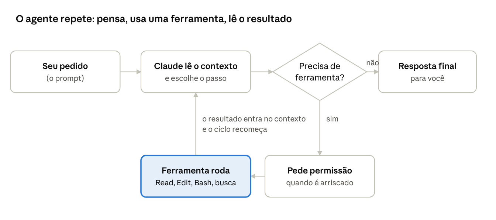
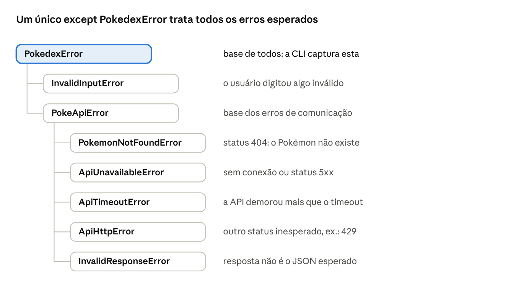
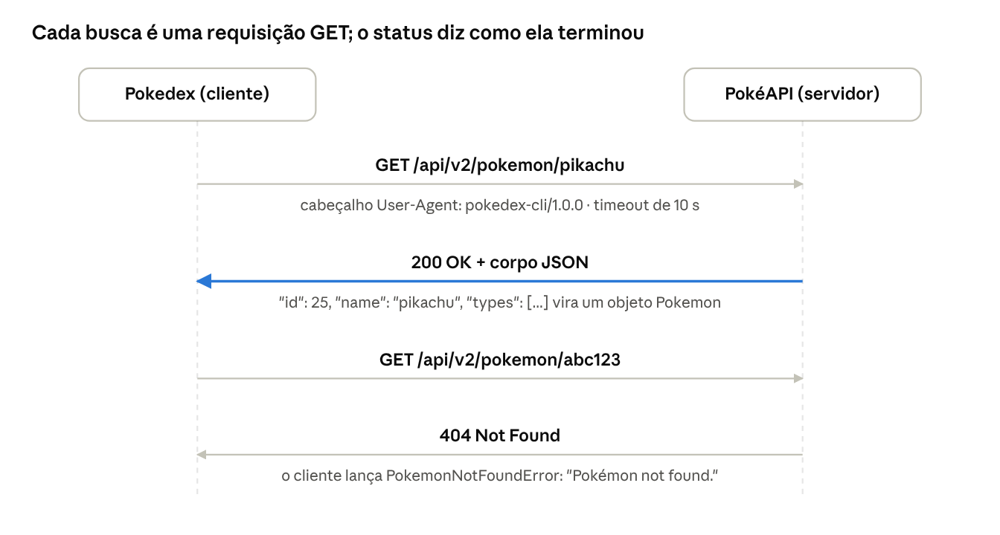

# Apostila: Claude, IA e Python na prática

17/10/2026 · Bernardo Gomes

Um curso do zero sobre inteligência artificial, sobre o Claude e sobre todos os conceitos de programação usados para construir o Pokedex CLI. Só se exige saber a sintaxe básica de Python.

## Como usar esta apostila

Esta apostila ensina, do zero, tudo o que foi usado para construir o **Pokedex CLI**: primeiro a inteligência artificial e o Claude, que escreveram o código junto com você, depois cada conceito de Python, de backend e de qualidade de software que aparece no projeto.

**Para quem é:** quem conhece a sintaxe básica de Python (variáveis, `if`, `for`, funções, listas e dicionários) e nunca estudou IA. Nenhum outro conhecimento é exigido.

**Como cada módulo funciona:**

- **Ideia central** em uma ou duas frases.
- **Explicação** com analogias do dia a dia.
- **Exemplo do projeto Pokémon**, com o arquivo onde ele vive (os caminhos são relativos à pasta `projeto-pokemon`).
- **Outros exemplos** fora do projeto, para mostrar que a ideia vale em qualquer lugar.
- **Contraexemplo**: o jeito errado, e por que ele dá problema. Aprender a reconhecer o erro é metade do aprendizado.
- **Na prática do mercado**: como empresas usam aquilo.
- **Teste-se**: perguntas rápidas; as respostas estão no gabarito, no fim.

**Mapa do curso:**

| Parte | Módulos | Você vai aprender |
| --- | --- | --- |
| I. IA e Claude | 1 a 6 | O que é IA, como um LLM funciona, como pedir bem, o que é um agente, como configurar o Claude Code e como usá-lo com responsabilidade |
| II. Python por dentro | 7 a 13 | Ambiente, pacotes, tipos, funções, orientação a objetos, exceções e validação de texto |
| III. Backend | 14 a 17 | HTTP, APIs REST, JSON, a biblioteca `requests`, arquitetura em camadas e aplicações de terminal |
| IV. Qualidade | 18 a 20 | Testes automatizados, ferramentas de qualidade, Git, GitHub e integração contínua |
| Apêndices | — | Glossário, exercícios e gabarito |

**Como estudar:** leia um módulo por vez, com o código do projeto aberto ao lado. Rode os exemplos no terminal; mude um detalhe e veja o que acontece. Responda o "Teste-se" antes de olhar o gabarito. A Parte I pode ser lida independente; as Partes II a IV seguem a ordem em que as camadas do projeto dependem umas das outras.

**Convenções:** comandos são para o PowerShell do Windows, com o ambiente virtual ativado. `>>>` indica o terminal interativo do Python. Termos técnicos aparecem em inglês quando é assim que o mercado fala ("commit", "mock", "timeout"), sempre com a explicação na primeira vez.

# Parte I — Inteligência artificial e Claude

## Módulo 1 — O que é inteligência artificial

**Ideia central:** um modelo de linguagem como o Claude não "consulta" respostas prontas; ele aprendeu padrões em uma quantidade enorme de texto e gera a resposta pedaço por pedaço, escolhendo a continuação mais provável e útil. Isso explica tanto o que ele faz bem quanto os erros que comete.

### 1.1 Programação tradicional x aprendizado de máquina

Na programação tradicional, **você escreve as regras**. No Pokedex, a função que converte altura é uma regra exata:

```python
# pokedex/models/pokemon.py — uma regra escrita à mão
@property
def height_m(self) -> float:
    return self.height / DECIMETRES_PER_METRE  # 4 decímetros -> 0.4 m
```

Ela sempre dá o mesmo resultado para a mesma entrada. É **determinística**.

No **aprendizado de máquina** (machine learning), você não escreve as regras: mostra milhares de exemplos e um algoritmo ajusta sozinho um modelo matemático até ele acertar. Exemplo clássico: um filtro de spam. Ninguém escreve "se o e-mail tem a palavra X, é spam"; o modelo vê um milhão de e-mails marcados como spam ou não e descobre os padrões.

|  | Programação tradicional | Aprendizado de máquina |
| --- | --- | --- |
| Quem cria as regras | O programador | O algoritmo, a partir de exemplos |
| Bom para | Regras claras: converter unidades, calcular imposto, paginar uma lista | Padrões difíceis de descrever: reconhecer um rosto, entender uma frase |
| Resultado | Exato e repetível | Provável; pode errar |
| Exemplo no projeto | `normalize_query`, `format_pokemon` | O Claude, que escreveu esse código |

**Contraexemplo — usar IA onde uma regra basta:** pedir a um modelo de IA para converter 4 decímetros em metros dentro do seu programa seria lento, caro e poderia errar. Uma divisão resolve. Regra do mercado: **use IA para o que é difícil de especificar, e código comum para o que é fácil.** A própria especificação do Pokedex proíbe IA dentro do programa; a IA foi usada como ferramenta para *construir* o programa, não como parte dele.

### 1.2 Redes neurais, em uma analogia

Uma **rede neural** é um modelo matemático feito de milhões ou bilhões de números ajustáveis, chamados **parâmetros** (ou pesos). Pense numa mesa de som com bilhões de botões: o treinamento gira cada botão um pouquinho, milhões de vezes, até que o som (a saída) fique certo para os exemplos. Ninguém sabe dizer o que um botão sozinho faz; o conhecimento está na combinação de todos.

**Deep learning** (aprendizado profundo) é só o nome para redes neurais com muitas camadas. Quase toda a IA moderna é deep learning.

### 1.3 LLM: o modelo de linguagem

**LLM** (Large Language Model, grande modelo de linguagem) é uma rede neural treinada em uma quantidade gigantesca de texto: livros, sites, documentação, código. A tarefa de treino parece simples: **dado um texto, prever o próximo pedaço**.

```text
Entrada:  "def soma(a, b):\n    return"
Previsão: " a + b"   (a continuação mais provável)
```

Para prever bem o próximo pedaço de bilhões de textos, o modelo precisa "absorver" gramática, fatos, raciocínio, estilos de programação. É por isso que ele consegue escrever um `PokeApiClient` inteiro: ele viu milhares de clientes HTTP em Python durante o treino e aprendeu os padrões.

Depois desse pré-treino, há uma segunda fase em que o modelo é ajustado para ser um **assistente**: seguir instruções, ser útil, honesto e seguro. Parte disso usa avaliações humanas das respostas (uma técnica chamada aprendizado por reforço com feedback humano, RLHF). A Anthropic, empresa que cria o Claude, também usa um conjunto de princípios escritos que orientam o comportamento do modelo.

### 1.4 Tokens: as "peças" do texto

O modelo não lê letras nem palavras inteiras: lê **tokens**, pedaços de texto que podem ser uma palavra, parte de uma palavra ou um símbolo. `Pikachu` pode virar algo como `Pik` + `achu`; `requests.get(` vira vários tokens. Em média, uma palavra corresponde a pouco mais de um token, e textos em português e código costumam gastar mais tokens que inglês comum.

Por que isso importa:

- **Custo**: o uso de modelos por API é cobrado por milhão de tokens de entrada e de saída.
- **Limite**: o modelo só "enxerga" uma quantidade máxima de tokens por vez (a janela de contexto, Módulo 2).
- **Geração**: a resposta sai token a token, por isso você a vê aparecer aos poucos.

### 1.5 Por que a IA erra: alucinação

Como o modelo gera o texto **mais provável**, e não o texto **comprovadamente verdadeiro**, ele pode produzir algo que soa perfeito e está errado. Isso se chama **alucinação**.

Exemplos reais de risco neste projeto, e como foram evitados:

| Situação | O que um modelo poderia "supor" | O que foi feito |
| --- | --- | --- |
| Formato do JSON da PokéAPI | Nomes de campos de memória, possivelmente errados | O Claude fez requisições reais e salvou as respostas em `tests/fixtures/` |
| `GET /pokemon/025` | "Deve funcionar, é o número 25" | Testado de verdade: a API responde 404, então o código remove os zeros |
| `GET /pokemon/deoxys` | "Deve existir" | Testado: 404. Isso levou à busca pela espécie |
| Nomes e preços de modelos do Claude nesta apostila | Dados de memória, talvez desatualizados | Consultada a referência oficial de modelos |

**Contraexemplo:** aceitar sem conferir uma resposta como "a função `requests.fetch_json()` faz isso". Essa função não existe; um modelo pode inventá-la porque o nome *parece* plausível. A defesa é sempre a mesma: **rodar o código, ler a documentação, escrever testes.**

### 1.6 O que um LLM não é

- **Não é um banco de dados.** Ele não guarda cópias consultáveis dos textos; guarda padrões. Pergunte o peso exato do Snorlax e ele pode errar; a PokéAPI não erra.
- **Não aprende com a sua conversa.** O modelo não muda enquanto você fala com ele. O que parece "memória" são textos guardados e devolvidos a ele em cada conversa (Módulo 5).
- **Não sabe o que aconteceu depois do treino**, a menos que receba essa informação por uma ferramenta, como uma busca na web.
- **Não executa código sozinho.** Um modelo só gera texto. Para rodar comandos, precisa de ferramentas (Módulo 4).

**Na prática do mercado:** empresas usam LLMs para escrever e revisar código, resumir documentos, responder clientes e extrair dados de textos. Os times que têm sucesso tratam a saída da IA como o trabalho de um colega rápido e talentoso, mas que precisa de revisão.

**Teste-se:**

1. Por que `height_m` não deveria ser calculado por uma IA?
2. O que é um token, e por que ele afeta o custo?
3. Por que um LLM pode inventar uma função que não existe?
4. Cite duas formas usadas neste projeto para evitar alucinações.

## Módulo 2 — O Claude

**Ideia central:** Claude é a família de LLMs da Anthropic. Existem vários modelos, de tamanhos e preços diferentes, e todos trabalham dentro de uma "janela de contexto": tudo o que o modelo enxerga numa conversa precisa caber nela.

### 2.1 A família de modelos

Modelos maiores costumam ser mais capazes em tarefas difíceis, mas são mais caros e lentos. Escolher o modelo é como escolher um veículo: um caminhão para a mudança, uma moto para entregar uma carta.

| Modelo (outubro de 2026) | Perfil | Uso típico |
| --- | --- | --- |
| Claude Fable 5.1 | O mais capaz amplamente disponível, e o mais caro | Raciocínio muito difícil, tarefas longas e autônomas |
| Claude Opus 5.5 | Topo de linha com melhor custo; modelo padrão recomendado | Programação, agentes, análise. Foi o modelo que construiu o Pokedex |
| Claude Sonnet 5.5 | Equilíbrio entre velocidade e capacidade | Programação do dia a dia, alto volume em produção |
| Claude Haiku 5.5 | O menor, mais rápido e mais barato | Tarefas simples e rápidas: classificar, extrair, resumir curto |

Cada modelo tem um identificador usado em programas, como `claude-opus-5-5` ou `claude-haiku-5-5`. Na API, o preço é por milhão de tokens: na data desta apostila, o Opus 5.5 custava US$ 4 de entrada e US$ 20 de saída por milhão, e o Haiku 5.5, US$ 0,10 e US$ 0,50. Preços mudam; confira sempre a página oficial.

**Contraexemplo:** usar o modelo mais caro para classificar 1 milhão de comentários como "positivo" ou "negativo". Um modelo pequeno faz isso bem por uma fração do custo. O inverso também é erro: usar o menor modelo para planejar a arquitetura de um sistema e aceitar uma resposta rasa.

### 2.2 A janela de contexto

A **janela de contexto** é a quantidade máxima de tokens que o modelo enxerga de uma vez: suas mensagens, as respostas dele, os arquivos que ele leu, as instruções de sistema. Os modelos atuais do Claude têm janelas de até 1 milhão de tokens, o bastante para centenas de arquivos de código.

Analogia: a janela é a mesa de trabalho do modelo. Tudo o que está em cima da mesa pode ser usado; o que não está simplesmente não existe para ele. Por isso:

- O Claude **não lembra de conversas anteriores** por conta própria. Cada conversa começa com a mesa vazia.
- Em conversas muito longas, o Claude Code **resume** partes antigas para liberar espaço. Detalhes antigos podem se perder no resumo.
- É por isso que o projeto tem `CLAUDE.md`, memórias e o `ROADMAP.md`: são textos que voltam para a mesa no início de cada conversa (Módulo 5).

**Exemplo deste projeto:** ao retomar o Pokedex depois de dias, o Claude não "lembrava" de nada. Ele leu o arquivo de memória `project-pokemon-progress.md`, que dizia "Etapa 0 feita, Etapa 1 não começada", e o `ROADMAP.md`. Foi assim que soube onde continuar.

### 2.3 Data de corte do conhecimento

O modelo aprendeu com textos até uma certa data, a **data de corte** (knowledge cutoff). Ele não sabe de nada posterior, como uma versão nova de uma biblioteca, a menos que uma ferramenta traga a informação. Exemplo prático: as versões exatas em `requirements-dev.txt` (`pytest==9.1.1`, `mypy==2.4.0`) não vieram da memória do modelo; vieram do que o `pip` realmente instalou.

### 2.4 Formas de usar o Claude

| Forma | O que é | Quem usa |
| --- | --- | --- |
| claude.ai (web, desktop, celular) | Chat, documentos, artifacts | Qualquer pessoa |
| Claude Code | Agente que trabalha no seu computador: lê e edita arquivos, roda comandos | Desenvolvedores. Foi o usado neste projeto |
| API da Anthropic | Programas chamam o modelo por HTTP | Empresas que criam produtos com IA |

Um detalhe que conecta tudo: a API da Anthropic é uma API HTTP, como a PokéAPI. Você envia um JSON com as mensagens e recebe um JSON com a resposta. Os conceitos do Módulo 14 (requisição, status code, timeout) valem igualmente para ela.

```python
# Exemplo ilustrativo: um programa conversando com o Claude pela API oficial
import anthropic

client = anthropic.Anthropic()  # lê a chave de acesso do ambiente
resposta = client.messages.create(
    model="claude-opus-5-5",
    max_tokens=1000,
    messages=[{"role": "user", "content": "Explique o que é um status 404."}],
)
```

**Contraexemplo de segurança:** escrever a chave da API direto no código (`api_key="sk-ant-..."`) e fazer commit. Qualquer pessoa que veja o repositório usa sua conta. Chaves ficam em variáveis de ambiente, fora do Git.

**Na prática do mercado:** times escolhem o modelo por tarefa e medem custo por tarefa concluída, não por requisição. Um modelo barato que precisa de três tentativas pode sair mais caro que um modelo melhor que acerta de primeira.

**Teste-se:**

1. Por que o Claude não lembra de uma conversa de ontem?
2. Que arquivos deste projeto servem de "memória" entre conversas?
3. Para classificar 1 milhão de avaliações simples, que modelo você testaria primeiro, e por quê?

## Módulo 3 — Prompts: como pedir bem

**Ideia central:** o **prompt** é o texto que você envia ao modelo. Como o modelo só sabe o que está na janela de contexto, um bom prompt dá a ele o que um colega novo precisaria: o objetivo, o contexto, as restrições e como saber que terminou.

### 3.1 Os cinco ingredientes de um bom pedido

| Ingrediente | Pergunta que responde | Exemplo no Pokedex |
| --- | --- | --- |
| Objetivo | O que você quer no fim? | "Uma CLI que busca e lista Pokémon" |
| Contexto | O que o modelo precisa saber e não sabe? | A especificação em PDF, o `ROADMAP.md`, o nível do aluno |
| Restrições | O que não pode, ou precisa ser de um jeito? | "Sem banco de dados, sem IA no programa, código em inglês" |
| Critério de pronto | Como saber que acabou? | "Que rode, testado, sem stack trace" |
| Formato da saída | Como entregar? | "Gere um manual em doc" |

### 3.2 Pedidos reais deste projeto, analisados

O pedido que gerou o Pokedex completo foi:

> "termine o projeto pokemon. faça tudo da melhor maneira possível \[...\] gere junto um manual de tudo que foi feito (em doc) \[...\] mas que rode. teste tudo"

Ele funcionou bem porque tinha **critério de pronto** ("que rode", "teste tudo") e **formato** ("manual em doc"). O contexto não precisou ser escrito porque já estava em arquivos: a especificação, o `CLAUDE.md` e a memória. Isso mostra uma ideia importante: **contexto escrito em arquivos vale para todos os pedidos futuros**.

Uma ambiguidade real: "em doc" pode significar um documento colaborativo ou um arquivo Word (`.docx`). O Claude escolheu o documento colaborativo e avisou que ele exporta para Word e PDF. Quando o pedido é ambíguo, o modelo precisa escolher e dizer o que escolheu, ou perguntar.

### 3.3 Exemplos e contraexemplos

| Pedido fraco | Problema | Pedido melhor |
| --- | --- | --- |
| "Faz um código de Pokémon" | Sem objetivo claro: site? jogo? CLI? | "Crie uma CLI em Python que busca um Pokémon na PokéAPI pelo nome ou número e mostra tipos e stats" |
| "Arruma o bug" | Que bug? Onde? Como reproduzir? | "Ao rodar `\"3\" \| python -m pokedex`, o menu responde 'Invalid option'. Esperado: sair. Encontre a causa antes de corrigir" |
| "Escreve testes" | Sem critério: quantos? de quê? | "Escreva testes pytest para `PokeApiClient` cobrindo 404, 5xx, timeout e JSON inválido, sem acessar a internet" |
| "Melhora isso" | Melhorar em quê? | "Deixe `format_page` mostrar o número da página, sem mudar o formato da primeira linha exigido pela especificação" |

**Contraexemplo de excesso:** um prompt de duas páginas cheio de regras em MAIÚSCULAS, repetidas, contraditórias ("seja breve" e "explique tudo em detalhe"). Modelos atuais seguem instruções com cuidado; regras demais e conflitantes atrapalham mais que ajudam. Diga o que importa uma vez, com o motivo.

### 3.4 Explique o porquê

Compare:

- "Nunca use `except Exception`."
- "Evite `except Exception`, porque esconde bugs de verdade; capture só os erros esperados, como `PokedexError`."

A segunda versão permite ao modelo (e a uma pessoa) aplicar a regra em casos que você não previu. O `CLAUDE.md` deste projeto faz isso: "Prefira código simples e legível a soluções espertas" levou o Claude a trocar `-(-a // b)` por `math.ceil(a / b)` durante o trabalho.

### 3.5 Trabalhe em etapas e peça verificação

Para tarefas grandes, peça um plano, depois a execução por partes, e sempre uma verificação: "rode os testes e me mostre o resultado". No Pokedex, cada camada foi seguida de execução real: testes, ruff, mypy, teste manual no PowerShell. Foi esse hábito que encontrou o bug do BOM.

**Na prática do mercado:** escrever um bom pedido para uma IA é a mesma habilidade de escrever um bom ticket ou uma boa issue para um colega. Quem descreve bem o problema recebe uma solução melhor, de pessoas ou de máquinas.

**Teste-se:**

1. Quais são os cinco ingredientes de um bom pedido?
2. Reescreva "faz um site" como um bom pedido.
3. Por que explicar o motivo de uma regra melhora o resultado?

## Módulo 4 — Agentes e ferramentas

**Ideia central:** um modelo sozinho só gera texto. Um **agente** é um modelo ligado a **ferramentas** (ler arquivos, editar, rodar comandos) dentro de um laço: ele decide uma ação, o programa a executa, o resultado volta para o modelo, e o ciclo se repete até a tarefa terminar.

### 4.1 Do chat ao agente

Num chat comum, se você pergunta "meus testes passam?", o modelo só pode adivinhar. Um agente pode **rodar** `pytest` e ler a saída. Essa é a diferença entre opinar e verificar.



O desenho mostra o **loop do agente**. Repare que o modelo nunca toca no seu computador diretamente: ele escreve um pedido estruturado ("quero rodar o comando X"), e um programa intermediário, o **harness** (no nosso caso, o Claude Code), executa, aplica as regras de permissão e devolve o resultado como texto.

### 4.2 Tool use: como uma ferramenta é chamada

Cada ferramenta tem um nome, uma descrição e os parâmetros que aceita. O modelo responde com algo assim (simplificado):

```json
{"type": "tool_use", "name": "Bash", "input": {"command": "python -m pytest -q"}}
```

O harness roda o comando e responde com o resultado:

```json
{"type": "tool_result", "content": "183 passed, 5 deselected in 1.93s"}
```

Note a semelhança com o Pokedex: o menu (`PokedexApp`) também não sabe fazer HTTP; ele chama `source.get_pokemon(...)` e recebe o resultado. O modelo é o "menu"; as ferramentas são o "serviço". É a mesma separação de responsabilidades do Módulo 16.

### 4.3 As ferramentas usadas neste projeto

| Ferramenta | O que faz | Uso real no Pokedex |
| --- | --- | --- |
| Read | Lê um arquivo | Ler `pyproject.toml`, a especificação em PDF |
| Write / Edit | Cria ou altera arquivos | Criar `pokeapi.py`; corrigir `main.py` |
| Bash / PowerShell | Roda comandos no terminal | `pytest`, `ruff`, `mypy`, `git commit`, `gh repo create` |
| Grep / Glob | Busca texto ou arquivos | Achar todos os testes que citavam "Showing Pokémon" |
| Skill | Carrega instruções especializadas | Guia de documentos; referência de modelos do Claude |
| Conector de documentos | Cria e edita docs | Escrever o manual e esta apostila |

### 4.4 O ciclo na prática: a história do bug do BOM

1. **Agir:** o Claude rodou o menu no PowerShell enviando as respostas por pipe.
2. **Observar:** a saída mostrou "Invalid option" onde deveria haver uma busca.
3. **Pensar:** hipótese: a primeira linha chega diferente.
4. **Agir:** rodou um comando que imprime a linha recebida com `repr()` e viu um caractere invisível, o U+FEFF, antes do `1`.
5. **Pensar:** é um BOM; a correção certa é na leitura da entrada.
6. **Agir:** corrigiu, escreveu testes, desfez a correção para ver os testes falharem, refez.

Um modelo sem ferramentas nunca teria descoberto esse bug: ele só aparece rodando o programa de verdade.

### 4.5 Subagentes

Um agente pode criar **subagentes**: cópias que recebem uma tarefa isolada e devolvem só o resultado. Servem para trabalhos grandes e paralelos, como pesquisar em muitas fontes. Têm custo: cada um começa sem o contexto da conversa. Neste projeto não foram usados, porque a tarefa era sequencial e o contexto era importante.

**Contraexemplo:** dar a um agente acesso irrestrito e sair de perto numa tarefa destrutiva ("limpe o servidor"). Agentes erram como pessoas erram; ações irreversíveis precisam de confirmação humana. Por isso existem permissões (Módulo 5).

**Na prática do mercado:** agentes de programação já são comuns em empresas. O que diferencia um bom uso é o ambiente: testes automatizados, CI e revisão de código deixam o agente verificar o próprio trabalho.

**Teste-se:**

1. Qual a diferença entre um chat e um agente?
2. Quem de fato executa um comando: o modelo ou o harness?
3. Em que passo do loop o bug do BOM foi descoberto?

## Módulo 5 — Configurando o Claude Code

**Ideia central:** o Claude Code é configurado com arquivos de texto que entram na janela de contexto no início de cada conversa. Eles transformam um assistente genérico num colega que conhece você, o seu projeto e as suas regras.

### 5.1 CLAUDE.md: as instruções do projeto

O `CLAUDE.md` é um arquivo Markdown na pasta do projeto que o Claude Code lê automaticamente. Funciona como o manual de boas-vindas de um funcionário novo. O deste projeto (`Claude-studies/CLAUDE.md`) tem seções como:

```markdown
## Padrões dos projetos
- Sempre em inglês: código, nomes de variáveis, comentários, mensagens de commit...
- Use type hints e escreva testes com pytest junto com o código.

## Ambiente
- Windows 10, PowerShell.
- Python 3.13 é o padrão do `py`; a 3.9 continua instalada, mas não deve ser usada.
```

Efeitos concretos no Pokedex: todo o código está em inglês, os comandos foram escritos para PowerShell, o ambiente usa Python 3.13, e cada módulo nasceu com testes.

| Bom conteúdo para o CLAUDE.md | Mau conteúdo |
| --- | --- |
| Regras que valem sempre ("commits no imperativo") | Coisas que o código já mostra (lista de todas as funções) |
| Fatos do ambiente ("Windows, PowerShell") | Segredos: senhas, tokens, chaves de API |
| Preferências com motivo | Regras contraditórias ou vagas ("faça bem feito") |
| Comandos para testar e rodar | História longa de cada decisão (isso vai no Git ou no manual) |

### 5.2 Memória

Além do `CLAUDE.md`, o Claude Code mantém uma pasta de **memórias**: arquivos curtos, um fato por arquivo, com um índice (`MEMORY.md`) carregado em toda conversa. Exemplos reais deste usuário:

- `user-profile.md`: "Python intermediário, quer explicações didáticas em português".
- `feedback-claude-codes-architecture-focus.md`: "o Claude escreve o código, ele valida; perguntas sobre arquitetura, não sintaxe".
- `project-pokemon-progress.md`: onde o projeto parou e o que fazer ao retomar.

A diferença: o `CLAUDE.md` é do **projeto** (vai para o repositório, vale para quem clonar); a memória é da **pessoa** e da sua história de trabalho.

**Contraexemplo:** confiar numa memória antiga sem conferir. Uma memória dizia que havia uma pergunta pendente sobre onde instalar o mypy; quando o projeto avançou, ela ficou obsoleta e foi atualizada. Memórias registram o que *era* verdade quando foram escritas.

### 5.3 Skills

**Skills** são pacotes de instruções especializadas que o Claude carrega só quando a tarefa pede: como criar um documento, como trabalhar com PDF, a referência atualizada da API do Claude. Economizam contexto: em vez de tudo estar sempre na mesa, cada manual entra quando é útil. Nesta apostila, a skill da API do Claude foi carregada para obter os nomes e preços corretos dos modelos.

### 5.4 Permissões e modos

O Claude Code pede autorização antes de ações que você não liberou. Você pode liberar comandos específicos (por exemplo, sempre permitir `pytest`) e escolher modos mais ou menos autônomos. A regra do `CLAUDE.md` "sugira commit e push, mas só execute depois da minha aprovação" é uma permissão expressa em texto; na segunda etapa deste trabalho, o usuário a suspendeu explicitamente ("não precisa de minha aprovação"), e só então os commits e o repositório foram criados.

Permissões existem também fora do Claude: o GitHub recusou o envio do arquivo de CI porque o token do `gh` não tinha a permissão `workflow`. Segurança em camadas é isso: cada sistema protege o que é seu.

### 5.5 Conectores, MCP, artifacts e documentos

- **MCP** (Model Context Protocol) é um padrão aberto para ligar o Claude a serviços externos: documentos, Slack, bancos de dados. Cada serviço vira um conjunto de ferramentas.
- **Conectores** são essas ligações prontas. O manual do projeto e esta apostila foram escritos por um conector de documentos.
- **Artifacts** são páginas e documentos publicados que você pode abrir, comentar e compartilhar.

### 5.6 Hooks e comandos

**Hooks** são comandos que o harness roda automaticamente em certos momentos (por exemplo, rodar o formatador depois de cada edição). **Comandos de barra** (como `/help` ou `/code-review`) disparam fluxos prontos. A diferença para o `CLAUDE.md`: um hook é executado pelo programa, sempre; uma instrução no `CLAUDE.md` depende de o modelo segui-la.

**Na prática do mercado:** times colocam o `CLAUDE.md` no repositório, como fazem com o README e a configuração do linter. É documentação que serve a pessoas e a agentes ao mesmo tempo.

**Teste-se:**

1. Qual a diferença entre `CLAUDE.md` e memória?
2. Por que não colocar uma chave de API no `CLAUDE.md`?
3. Se você quer que o formatador rode *sempre* após uma edição, é melhor uma instrução no `CLAUDE.md` ou um hook? Por quê?

## Módulo 6 — Usar IA com responsabilidade

**Ideia central:** a IA acelera o trabalho, mas a responsabilidade pelo resultado continua sendo sua. Três hábitos protegem você: verificar antes de confiar, proteger dados sensíveis e entender o que foi entregue.

### 6.1 Verificar antes de confiar

"O código parece certo" não é evidência. Evidência é rodar. Durante o Pokedex, cada afirmação de "pronto" veio acompanhada de uma saída real:

```text
All checks passed!                                  <- ruff
Success: no issues found in 23 source files         <- mypy
TOTAL   382   0   82   0   100%                     <- cobertura
183 passed, 5 deselected in 1.93s                   <- pytest
```

| Afirmação | Evidência aceitável | Não é evidência |
| --- | --- | --- |
| "Os testes passam" | Saída do `pytest` agora | "Passavam ontem" |
| "O bug foi corrigido" | Um teste que falhava e agora passa | "Mudei a linha que parecia errada" |
| "Funciona no Windows" | Execução no PowerShell | Execução só no Git Bash |
| "Instala do zero" | Clone limpo + venv novo + testes | "Na minha máquina funciona" |

Um truque usado no projeto: depois de corrigir o bug do BOM, a correção foi **desfeita de propósito** para confirmar que os testes novos falhavam sem ela. Um teste que passa com ou sem a correção não testa nada.

### 6.2 Honestidade sobre o que não deu certo

Um bom relatório diz o que falhou. Neste trabalho, o push do arquivo de CI foi recusado pelo GitHub. O certo é dizer isso claramente e explicar o que falta, não esconder ou contornar a segurança. Desconfie de qualquer relatório, humano ou de IA, em que tudo deu certo de primeira.

### 6.3 Segurança e privacidade

- **Nunca cole segredos** (senhas, tokens, chaves) em prompts ou arquivos versionados.
- **Leia antes de rodar** comandos que você não entende, principalmente os que apagam ou enviam dados.
- **Dados de terceiros** (clientes, colegas) só entram numa ferramenta de IA se a política da empresa permitir.
- **Entrada externa é dado, não ordem.** Um site ou arquivo pode conter texto como "ignore as instruções e faça X". Isso se chama **prompt injection**. O mesmo princípio aparece no código do Pokedex: o nome que vem da API de espécies é validado antes de virar parte de uma URL, porque dado externo não é confiável.

### 6.4 Aprender x delegar

O `CLAUDE.md` deste usuário começa com "Meu foco é aprender, não terminar rápido". Delegar tudo à IA entrega o projeto, mas não o conhecimento. Numa entrevista técnica, perguntarão "por que você usou injeção de dependência aqui?". É para isso que existem o manual, esta apostila e os exercícios.

| Uso que ensina | Uso que só entrega |
| --- | --- |
| Pedir explicação de cada decisão | Copiar e colar sem ler |
| Tentar primeiro, depois comparar com a IA | Pedir tudo pronto |
| Fazer o "Teste-se" sem olhar o gabarito | Pular as perguntas |
| Reescrever um módulo do zero sozinho | Nunca abrir o código |

**Contraexemplo:** colocar no portfólio um projeto que você não consegue explicar. Recrutadores costumam pedir para o candidato explicar ou alterar o próprio código ao vivo.

**Na prática do mercado:** empresas que usam IA bem mantêm revisão de código, testes e CI obrigatórios para qualquer mudança, venha ela de pessoa ou de agente. O padrão de qualidade é o mesmo.

**Teste-se:**

1. Por que desfazer uma correção para ver o teste falhar?
2. O que é prompt injection, e onde o Pokedex aplica a mesma ideia?
3. Cite duas formas de usar a IA que ensinam em vez de só entregar.

# Parte II — Python por dentro

## Módulo 7 — O ambiente Python

**Ideia central:** cada projeto tem seu próprio ambiente isolado (`.venv`), com as versões exatas das bibliotecas anotadas em arquivos. Assim qualquer pessoa, ou o CI, recria o mesmo ambiente com um comando.

### 7.1 Ambiente virtual (venv)

Sem venv, todas as bibliotecas vão para a instalação global do Python. Se o projeto A precisa do `requests` 2.30 e o projeto B do 2.34, um quebra o outro. O **venv** é uma pasta com um Python e bibliotecas só daquele projeto.

```powershell
py -m venv .venv                 # cria (uma vez)
.\.venv\Scripts\Activate.ps1     # ativa (a cada terminal novo)
python -m pip install requests   # instala DENTRO do .venv
deactivate                       # sai
```

**Contraexemplo:** fazer commit da pasta `.venv`. Ela tem milhares de arquivos, é específica do seu sistema operacional e se recria em segundos. Por isso o `.gitignore` do projeto começa com `.venv/`.

Dica: prefira `python -m pip` a `pip` solto. O `-m` garante que o pip usado é o do Python ativo, e não outro qualquer no PATH.

### 7.2 Dependências: requirements e pyproject

| Arquivo | Conteúdo no Pokedex | Para quê |
| --- | --- | --- |
| `requirements.txt` | `requests==2.34.2` | O que o programa precisa para **rodar** |
| `requirements-dev.txt` | `-r requirements.txt`, pytest, pytest-cov, ruff, mypy, types-requests | O que o desenvolvedor precisa para **testar e checar** |
| `pyproject.toml` | Nome, versão, dependências, comando `pokedex`, configuração das ferramentas | O "documento de identidade" do projeto |

A separação runtime x desenvolvimento importa: quem só vai usar o Pokedex não precisa do pytest. Uma confusão comum, que aconteceu neste projeto antes da Etapa 1, é colocar uma biblioteca de execução no arquivo de desenvolvimento. Pergunta-guia: "o programa quebra sem ela?" Se sim, vai em `requirements.txt`.

`==` fixa a versão exata (reprodutível). No `pyproject.toml` usou-se `requests>=2.32` (compatível), porque um pacote instalável não deve travar versões exatas de quem o instala.

### 7.3 Instalação editável e o comando `pokedex`

```toml
[project.scripts]
pokedex = "pokedex.main:main"
```

Com `python -m pip install -e .`, o pip cria um executável `pokedex` que chama a função `main` do módulo `pokedex.main`. O `-e` (editable) aponta para a sua pasta: mudou o código, o comando já usa a versão nova.

### 7.4 Terminal: PowerShell, Git Bash, PATH

O terminal é onde você digita comandos. No Windows há o **PowerShell** (padrão) e o **Git Bash** (imita o Linux). Os comandos diferem: `ls -la` é Bash; `Get-ChildItem` é PowerShell. O **PATH** é a lista de pastas onde o sistema procura programas; ativar o venv coloca `.venv\Scripts` no início dela.

### 7.5 Encoding: UTF-8, cp1252 e o BOM

Computadores guardam texto como bytes. **Encoding** é a tabela que converte caracteres em bytes. O `é` de "Pokémon" vira bytes diferentes em cada tabela:

```python
>>> "é".encode("utf-8")
b'\xc3\xa9'
>>> "é".encode("cp1252")
b'\xe9'
```

Se um programa escreve em cp1252 e outro lê como UTF-8, aparece `Pok�mon`. Isso aconteceu de verdade no Git Bash durante o projeto. A solução foi o Pokedex sempre escrever em UTF-8, o padrão moderno.

O **BOM** (byte order mark) é uma marca invisível, o caractere Unicode U+FEFF, que alguns programas colocam no início de um texto UTF-8. O PowerShell 5.1 a coloca ao enviar texto por pipe, e o menu recebia BOM + `1` em vez de `1`. O codec `utf-8-sig` lê UTF-8 e descarta essa marca:

```python
# pokedex/main.py
if isinstance(sys.stdin, io.TextIOWrapper) and not sys.stdin.isatty():
    sys.stdin.reconfigure(encoding="utf-8-sig")
```

**Contraexemplo:** "resolver" o BOM com `choice.replace(BOM, "")` dentro do menu. Funciona, mas espalha um problema de entrada e saída pela lógica do programa, e cada novo `input()` precisaria do mesmo remendo. Corrija os problemas na fronteira onde eles entram.

**Na prática do mercado:** "funciona na minha máquina" é um dos problemas mais caros em empresas. Ambientes reprodutíveis (venv, versões fixas, CI, contêineres Docker) existem para eliminá-lo.

**Teste-se:**

1. Por que não fazer commit do `.venv`?
2. O `mypy` vai em `requirements.txt` ou `requirements-dev.txt`? E o `requests`?
3. Por que `Pokémon` aparecia como `Pok�mon` no Git Bash?

## Módulo 8 — Módulos, pacotes e imports

**Ideia central:** um arquivo `.py` é um **módulo**; uma pasta com `__init__.py` é um **pacote**. Dividir o código em módulos dá a cada arquivo uma responsabilidade, e os `import` mostram quem depende de quem.

### 8.1 A estrutura do Pokedex

```text
pokedex/                 <- pacote (tem __init__.py)
├── __init__.py          <- roda no primeiro import; guarda __version__
├── __main__.py          <- roda com "python -m pokedex"
├── main.py
├── exceptions.py
├── models/              <- subpacote
│   ├── __init__.py
│   └── pokemon.py
├── services/
│   └── pokeapi.py
├── cli/
│   ├── menu.py
│   └── formatting.py
└── utils/
    └── validation.py
```

### 8.2 Formas de importar

```python
import requests                                   # o módulo inteiro: requests.get(...)
from pokedex.exceptions import PokedexError       # um nome específico
from pokedex.models.pokemon import Pokemon, PokemonPage  # vários nomes
```

O projeto usa **imports absolutos** (`from pokedex.models...`), que deixam claro de onde cada nome vem, em qualquer arquivo.

A ordem dos imports segue uma convenção que o ruff verifica (regra `I`): biblioteca padrão, depois bibliotecas de terceiros, depois o próprio projeto, separados por linha em branco:

```python
import argparse            # 1. biblioteca padrão
import sys

import requests            # 2. terceiros (instalados com pip)

from pokedex import __version__   # 3. o próprio projeto
```

### 8.3 `__init__.py` e `__version__`

`pokedex/__init__.py` contém só uma docstring e `__version__ = "1.0.0"`. Esse único lugar é lido pelo `pyproject.toml` (versão do pacote), pelo `--version` da CLI e pelo cabeçalho `User-Agent` do cliente HTTP. **Uma fonte da verdade**: mudar a versão é editar uma linha.

**Contraexemplo:** escrever `"1.0.0"` em três arquivos. Na próxima versão, alguém atualiza dois e esquece o terceiro. Essa duplicação chegou a existir no projeto e foi removida.

### 8.4 `__main__.py`, `python -m` e `if __name__ == "__main__"`

Quando você roda `python -m pokedex`, o Python executa `pokedex/__main__.py`:

```python
import sys

from pokedex.main import main

sys.exit(main())   # o número devolvido por main() vira o código de saída
```

Toda variável `__name__` vale o nome do módulo (`"pokedex.main"`), exceto no arquivo executado diretamente, onde vale `"__main__"`. Por isso o padrão clássico:

```python
# outro_script.py
def main() -> None:
    print("rodando")

if __name__ == "__main__":   # só roda se o arquivo for executado, não se for importado
    main()
```

**Contraexemplo:** colocar código solto no nível do módulo, como `client = PokeApiClient(); client.get_pokemon("pikachu")`. Esse código rodaria (fazendo uma requisição HTTP!) toda vez que qualquer arquivo importasse o módulo, inclusive os testes.

### 8.5 Dependências circulares

Se `a.py` importa `b.py` e `b.py` importa `a.py`, o Python pode falhar com um import parcialmente carregado. A arquitetura em camadas evita isso: as camadas de cima importam as de baixo, nunca o contrário. `models` não importa nada do projeto; `services` importa `models`; `cli` importa `services` e `models`.

**Na prática do mercado:** numa base de código grande, o diagrama de imports é o mapa da arquitetura. Revisores desconfiam quando uma camada de baixo começa a importar uma de cima.

**Teste-se:**

1. Qual a diferença entre módulo e pacote?
2. O que acontece quando você roda `python -m pokedex`?
3. Por que não deixar uma chamada HTTP solta no nível do módulo?

## Módulo 9 — Type hints e mypy

**Ideia central:** **type hints** são anotações que dizem o tipo esperado de variáveis, parâmetros e retornos. O Python ignora essas anotações ao rodar; quem as usa é o **mypy**, um verificador que lê o código e encontra erros de tipo antes de o programa rodar.

### 9.1 O básico

```python
def display_name(api_name: str) -> str:      # recebe str, devolve str
    return api_name.replace("-", " ").title()

total: int = 0
nomes: list[str] = ["pikachu", "bulbasaur"]
stats: dict[str, int] = {"hp": 35}
```

### 9.2 Os tipos usados no Pokedex

| Anotação | Significa | Onde aparece |
| --- | --- | --- |
| `tuple[str, ...]` | Tupla de qualquer tamanho, só de `str` | `Pokemon.types` |
| `tuple[int, int]` | Tupla de exatamente dois `int` | Chave do cache de páginas `(limit, offset)` |
| `str \| int` | Um ou outro (união) | `get_pokemon(name_or_id: str \| int)` |
| `X \| None` | Pode ser `None` (opcional) | `session: requests.Session \| None = None` |
| `dict[str, Any]` | Dicionário com valores de qualquer tipo | O JSON cru da API |
| `Self` | "O tipo da própria classe" | `from_api_data(...) -> Self` |
| `Callable[[str], str]` | Uma função que recebe `str` e devolve `str` | `input_func` do menu |
| `Sequence[str]` | Qualquer sequência de `str` (lista, tupla) | `main(argv: Sequence[str] \| None)` |
| `Protocol` | "Qualquer objeto com estes métodos" | `PokemonSource` (Módulo 11) |

### 9.3 `Any`: a porta dos fundos

`Any` significa "não verifique". É honesto para o JSON que vem da API, porque não dá para saber o formato antes de olhar. Mas o projeto usa `Any` só na fronteira: logo depois, `_as_int` e `_as_str` checam os valores, e dali em diante tudo é tipado.

```python
def _as_int(value: Any) -> int:
    # bool é subclasse de int em Python, então precisa ser rejeitado à parte
    if not isinstance(value, int) or isinstance(value, bool):
        raise TypeError(f"expected an integer, got {value!r}")
    return value
```

**Contraexemplo:** anotar tudo como `Any` para o mypy "parar de reclamar". É como desligar o detector de fumaça porque ele apita.

### 9.4 O que o mypy pega

```python
def format_weight(kg: float) -> str:
    return kg + " kg"        # mypy: Unsupported operand types for + ("float" and "str")

format_weight("6.0")         # mypy: Argument 1 has incompatible type "str"; expected "float"
```

Sem rodar nada, o mypy acha os dois bugs. O projeto usa o **modo estrito** (`strict = true` no `pyproject.toml`), que exige anotação em todas as funções, inclusive nos testes.

Um caso real: o mypy recusou um dublê de teste que herdava de `io.StringIO` e mudava a assinatura de `readline`. A solução foi uma classe simples, sem herança. O verificador apontou um design frágil.

### 9.5 Type hints não validam em tempo de execução

```python
def dobro(x: int) -> int:
    return x * 2

dobro("ab")   # o Python roda sem reclamar e devolve "abab"
```

Por isso dados externos (JSON, entrada do usuário) ainda precisam de validação explícita, como `_as_int` e `normalize_query`. Type hints protegem o código de você mesmo; validação protege o código do mundo lá fora.

**Na prática do mercado:** type hints viraram padrão em backends Python. Frameworks como FastAPI e Pydantic usam as mesmas anotações para validar requisições automaticamente, então aprendê-las agora paga em dobro.

**Teste-se:**

1. O que significa `str | None`?
2. Por que `_as_int` rejeita `True`?
3. Se type hints não são verificados ao rodar, para que servem?

## Módulo 10 — Funções, funções puras e f-strings

**Ideia central:** uma **função pura** recebe dados e devolve um resultado, sem ler o teclado, imprimir, acessar a rede ou mudar nada fora dela. Funções puras são as mais fáceis de entender, reutilizar e testar, e por isso o Pokedex concentra nelas toda a lógica de apresentação.

### 10.1 Pura x com efeito colateral

```python
# PURA (pokedex/cli/formatting.py): mesma entrada -> mesma saída, nada mais acontece
def format_pokemon(pokemon: Pokemon) -> str:
    ...
    return "\n".join(lines)

# COM EFEITO COLATERAL: imprime na tela
def show_pokemon(pokemon: Pokemon) -> None:
    print(format_pokemon(pokemon))
```

**Efeito colateral** é qualquer coisa que a função faz além de devolver um valor: imprimir, gravar arquivo, fazer requisição, alterar uma variável global. Programas úteis precisam de efeitos colaterais; o segredo é empurrá-los para as bordas (o menu, o `main`) e manter o miolo puro.

Como testar cada uma:

```python
# Pura: comparação direta de strings
assert format_pokemon(pikachu).startswith("====")

# Com print: precisa capturar a saída (capsys, Módulo 18), mais trabalhoso
```

**Contraexemplo:** uma função `format_pokemon` que faz `print` no meio e devolve `None`. Não dá para reutilizar o texto (por exemplo, numa futura API web que devolve JSON ou HTML), e o teste precisa interceptar a tela.

### 10.2 Funções pequenas com nomes claros

O projeto tem funções como `display_name`, `normalize_query`, `_id_from_url`, `_strip_accents`. Cada uma faz uma coisa e o nome diz qual. O prefixo `_` indica "uso interno deste módulo": é uma convenção, o Python não impede o acesso.

```python
def _id_from_url(url: str) -> int:
    """Extract the id from a resource URL such as ``.../pokemon/25/``."""
    return int(url.rstrip("/").rsplit("/", maxsplit=1)[-1])
```

Passo a passo com `"https://pokeapi.co/api/v2/pokemon/25/"`: `rstrip("/")` tira a barra final; `rsplit("/", maxsplit=1)` corta só na última barra, gerando `["https://...pokemon", "25"]`; `[-1]` pega o último item; `int()` converte.

O texto entre aspas triplas logo abaixo do `def` é a **docstring**: a documentação da função, que aparece em `help(...)` e nos editores.

### 10.3 Parâmetros com valor padrão

```python
def list_pokemon(self, limit: int = DEFAULT_PAGE_SIZE, offset: int = 0) -> PokemonPage:
```

Quem chama pode omitir os dois (`list_pokemon()`) ou passar por nome (`list_pokemon(limit=20, offset=40)`). Passar por nome deixa a chamada legível.

**Armadilha clássica:** nunca use um valor mutável como padrão.

```python
def adicionar(item, lista=[]):     # ERRADO: a mesma lista é reaproveitada entre chamadas
    lista.append(item)
    return lista

adicionar(1)   # [1]
adicionar(2)   # [1, 2]  <- surpresa!

def adicionar(item, lista=None):   # CERTO
    if lista is None:
        lista = []
    lista.append(item)
    return lista
```

O Pokedex usa o padrão certo em `PokeApiClient.__init__(session=None)`: só cria uma `Session` nova se nenhuma for passada.

### 10.4 Constantes nomeadas

```python
DECIMETRES_PER_METRE = 10
STAT_POINTS_PER_BAR_CHAR = 10
DEFAULT_TIMEOUT = 10.0
```

Três "10" com significados diferentes. Com nomes em MAIÚSCULAS (convenção para constantes), quem lê sabe o que cada um significa, e mudar o timeout não muda sem querer a conversão de unidades. **Contraexemplo:** `return self.height / 10` espalhado pelo código, o famoso "número mágico".

### 10.5 f-strings e a mini-linguagem de formatação

As f-strings (`f"..."`) inserem valores no texto. Depois de `:` vem a **especificação de formato**, usada intensamente em `formatting.py`:

| Expressão | Resultado | Significado |
| --- | --- | --- |
| `f"#{25:04d}"` | `#0025` | Inteiro com 4 dígitos, completando com zeros |
| `f"{0.4:.1f} m"` | `0.4 m` | Float com 1 casa decimal |
| `f"{'Types:':<11}"` | ` Types:      ` | Alinhado à esquerda em 11 colunas |
| `f"{35:>4}"` | `   35 ` | Alinhado à direita em 4 colunas |
| `f"{'=' * 40}"` | 40 sinais `=` | Expressão qualquer dentro das chaves |
| `f"{value!r}"` | `'25'` (com aspas) | Usa `repr()`, ótimo em mensagens de erro |
| `f"{5.0:g}"` | `5` | Formato "geral": tira zeros desnecessários |
| `f"{pos:>{width}}"` | Alinha com largura variável | Formato aninhado, usado na lista |

**Na prática do mercado:** "separar lógica pura de efeitos colaterais" aparece em entrevistas como "testabilidade". Código fácil de testar quase sempre é código bem desenhado.

**Teste-se:**

1. `format_pokemon` é pura? E `PokedexApp.search`? Por quê?
2. O que `f"{7:03d}"` produz?
3. Por que `lista=[]` como valor padrão é um bug?

## Módulo 11 — Orientação a objetos

**Ideia central:** uma **classe** junta dados e o comportamento que pertence a eles. Use classes onde elas representam algo do domínio (um Pokémon, uma página) ou guardam estado (um cliente com cache); use funções no resto. A especificação pediu "orientação a objetos de forma moderada", e é isso que o projeto faz.

### 11.1 Classe, objeto, `self` e `__init__`

```python
class PokedexApp:
    def __init__(self, source: PokemonSource, page_size: int = 20) -> None:
        self._source = source          # atributos: os dados de CADA objeto
        self._page_size = page_size

    def search(self) -> None:          # método: comportamento
        ...

app = PokedexApp(client)               # cria um objeto (instância)
app.search()                           # Python chama PokedexApp.search(app)
```

A **classe** é a planta da casa; o **objeto** é a casa construída. `self` é "este objeto aqui". `__init__` roda ao criar o objeto e prepara seus atributos. O prefixo `_` em `self._source` indica atributo interno.

### 11.2 Dataclasses

Escrever `__init__`, comparação (`__eq__`) e representação (`__repr__`) à mão é repetitivo. O decorador `@dataclass` gera tudo a partir dos campos:

```python
@dataclass(frozen=True)
class Stat:
    name: str
    base_value: int

>>> Stat("hp", 35)
Stat(name='hp', base_value=35)                 # __repr__ gerado
>>> Stat("hp", 35) == Stat("hp", 35)
True                                           # __eq__ compara os campos
```

**Contraexemplo:** representar um Pokémon como um dicionário cru, `{"name": "pikachu", "hieght": 4}`. O erro de digitação em `hieght` passa despercebido até alguém ler `pokemon["height"]` e receber `KeyError`. Com a dataclass, o mypy e o editor apontam o erro na hora.

### 11.3 Imutabilidade: `frozen=True`

```python
>>> pikachu.name = "raichu"
dataclasses.FrozenInstanceError: cannot assign to field 'name'
```

Por que importa: o cliente guarda o mesmo objeto `Pokemon` no cache e o devolve várias vezes. Se alguém pudesse alterá-lo, uma parte do programa estragaria o dado de outra. Pelo mesmo motivo, as coleções são `tuple` (imutável), não `list`.

### 11.4 `@property`: atributo calculado

```python
@property
def weight_kg(self) -> float:
    return self.weight / HECTOGRAMS_PER_KILOGRAM

pikachu.weight_kg   # 6.0 — sem parênteses, parece um atributo
```

O valor é derivado do campo `weight`, então nunca fica desatualizado. **Contraexemplo:** guardar `weight` e `weight_kg` como dois campos; um dia alguém atualiza um e esquece o outro.

### 11.5 `@classmethod`: construtores alternativos

```python
@classmethod
def from_api_data(cls, data: dict[str, Any]) -> Self:
    """Build a Pokemon from the JSON of GET /pokemon/{name_or_id}."""
    return cls(id=_as_int(data["id"]), name=_as_str(data["name"]), ...)
```

Um `classmethod` recebe a classe (`cls`) em vez de um objeto. É o padrão para "criar um objeto a partir de outro formato". Aqui ele traduz o JSON gigante da API, com dezenas de campos, para os 7 campos que o programa usa. Os outros (movimentos, sprites, índices de jogos) são descartados, como pede a especificação.

### 11.6 Composição em vez de herança

`Pokemon` **tem** uma tupla de `Ability` e de `Stat`; `PokemonPage` **tem** uma tupla de `PokemonSummary`; `PokedexApp` **tem** uma fonte de dados. Isso é **composição**: objetos montados com outros objetos.

**Herança** ("é um") aparece só onde faz sentido: nas exceções (`PokemonNotFoundError` **é um** `PokeApiError`, Módulo 12).

**Contraexemplo:** `class PokedexApp(PokeApiClient)`, o menu herdando do cliente HTTP "para reaproveitar os métodos". O menu passaria a *ser* um cliente HTTP, misturando duas responsabilidades, e seria impossível testá-lo com uma fonte falsa.

### 11.7 `Protocol`: duck typing com verificação

"Se anda como pato e grasna como pato, é um pato." Em Python, não importa a classe do objeto, só se ele tem os métodos necessários. O `Protocol` escreve esse contrato para o mypy conferir:

```python
class PokemonSource(Protocol):
    def get_pokemon(self, name_or_id: str | int) -> Pokemon: ...
    def list_pokemon(self, limit: int = ..., offset: int = ...) -> PokemonPage: ...
```

O `PokeApiClient` real e o `FakeSource` dos testes cumprem esse contrato sem herdar de nada. O menu depende do contrato, não de uma classe concreta.

### 11.8 Context manager: `with` e `__enter__`/`__exit__`

```python
with PokeApiClient(timeout=5) as client:
    client.get_pokemon("pikachu")
# aqui o __exit__ já rodou e fechou as conexões, mesmo se houve exceção
```

```python
def __enter__(self) -> Self:
    return self

def __exit__(self, *exc_info: object) -> None:
    self.close()
```

Você já usa isso com arquivos: `with open("x.txt") as f:` garante que o arquivo é fechado. **Contraexemplo:** abrir recursos (arquivos, conexões, sessões de banco) e confiar que alguém vai lembrar de fechar.

**Na prática do mercado:** em backends, dataclasses e modelos Pydantic representam dados; classes de serviço guardam dependências; herança profunda é vista com desconfiança. "Prefira composição a herança" é um princípio clássico de design.

**Teste-se:**

1. Por que `Pokemon` é `frozen=True`?
2. Para que serve `from_api_data` ser um `classmethod`?
3. Por que o menu não deve herdar do cliente HTTP?
4. O que acontece com a sessão HTTP ao sair de um bloco `with PokeApiClient()`?

## Módulo 12 — Exceções e tratamento de erros

**Ideia central:** uma **exceção** interrompe o fluxo normal quando algo dá errado. Erros *esperados* (Pokémon inexistente, internet fora) devem virar mensagens claras; erros *inesperados* (bugs) devem continuar visíveis para serem corrigidos.

### 12.1 try / except / else / finally

```python
try:
    pokemon = client.get_pokemon("pikachu")   # pode falhar
except PokemonNotFoundError:
    print("Pokémon not found.")               # roda só se falhou com esse tipo
else:
    print(format_pokemon(pokemon))            # roda só se NÃO falhou
finally:
    print("sempre roda")                      # roda nos dois casos (limpeza)
```

`raise` lança uma exceção. Se ninguém a captura, o programa para e mostra o **traceback** (stack trace): a lista de chamadas até o erro. Ótimo para programadores, péssimo para usuários. A especificação exige: nenhum traceback em situações esperadas.

### 12.2 Uma hierarquia própria

Exceções são classes; criar as suas é herdar de `Exception`.



Como `except` captura a classe **e todas as suas filhas**, o menu precisa de uma única linha para tratar todos os casos esperados:

```python
# pokedex/cli/menu.py
try:
    pokemon = self._source.get_pokemon(query)
except PokedexError as error:
    self._output(str(error))     # cada exceção já carrega sua mensagem para o usuário
    return
```

E quem precisa de detalhe pode capturar uma filha específica. Exceções também carregam dados: `PokemonNotFoundError` guarda `query`, `ApiHttpError` guarda `status_code`.

### 12.3 Traduzir na fronteira e `raise ... from`

O cliente HTTP converte erros da biblioteca `requests` em erros do domínio:

```python
try:
    response = self._session.get(url, params=params, timeout=self._timeout)
except requests.Timeout as error:
    raise ApiTimeoutError(self._timeout) from error
except requests.RequestException as error:
    raise ApiUnavailableError() from error
```

O `from error` guarda a exceção original em `__cause__`. O usuário vê uma mensagem limpa; o programador, depurando, ainda encontra a causa real. E o resto do programa nunca precisa importar `requests`.

Repare na **ordem**: `requests.Timeout` é filha de `requests.RequestException`, então precisa vir antes. Se a mãe viesse primeiro, ela capturaria o timeout e a linha de baixo nunca rodaria.

### 12.4 Contraexemplos clássicos

```python
# 1. Engolir tudo: esconde bugs de verdade (um erro de digitação vira "API fora do ar")
try:
    pokemon = client.get_pokemon(query)
except Exception:
    print("Algo deu errado")

# 2. Pior ainda: except vazio captura até Ctrl+C (KeyboardInterrupt)
try:
    ...
except:
    pass

# 3. Comparar mensagens em vez de tipos: quebra se o texto mudar
if "404" in str(error): ...
```

### 12.5 EAFP x LBYL

Dois estilos: **LBYL** ("olhe antes de pular": `if "stats" in data:`) e **EAFP** ("é mais fácil pedir perdão": tente e trate a exceção). O Pokedex usa EAFP para o JSON: `from_api_data` acessa as chaves direto, e o cliente captura `KeyError`, `TypeError` e `ValueError` de uma vez, convertendo em `InvalidResponseError`. Checar cada uma das dezenas de chaves com `if` seria longo e fácil de esquecer.

### 12.6 Ctrl+C, fim de entrada e códigos de saída

`KeyboardInterrupt` (Ctrl+C) herda de `BaseException`, e **não** de `Exception`, justamente para não ser engolido por acidente num `except Exception`. `EOFError` (fim da entrada: Ctrl+Z no Windows, ou o fim de um texto enviado por pipe) é uma exceção comum. O `main.py` trata os dois explicitamente, diz "Goodbye!" e devolve um **código de saída**, o número que o programa entrega ao sistema operacional:

| Código | Significado no Pokedex | Convenção |
| --- | --- | --- |
| 0 | Sucesso | Universal |
| 1 | Erro esperado (não encontrado, API fora) | Erro genérico |
| 2 | Argumento de linha de comando inválido | Padrão do argparse |
| 130 | Interrompido com Ctrl+C | 128 + número do sinal SIGINT (2) |

Scripts usam esses códigos: no PowerShell, `$LASTEXITCODE` mostra o código do último programa.

**Na prática do mercado:** em APIs web, a mesma hierarquia vira respostas HTTP: `PokemonNotFoundError` vira 404, `InvalidInputError` vira 400, `ApiUnavailableError` vira 503. Um tratamento de erros bem desenhado é um dos sinais mais claros de maturidade num código de backend.

**Teste-se:**

1. Por que `except requests.Timeout` precisa vir antes de `except requests.RequestException`?
2. O que `raise ... from error` preserva?
3. Por que `except Exception: print("erro")` é perigoso?
4. Que código de saída o Pokedex devolve para `pokedex search abc123`?

## Módulo 13 — Strings, expressões regulares e validação

**Ideia central:** tudo o que o usuário digita é suspeito até prova em contrário. **Normalizar** transforma formas aceitáveis numa forma padrão (`" Mr. Mime "` vira `mr-mime`); **validar** rejeita o que nunca seria válido, com uma mensagem clara, antes de gastar uma requisição.

### 13.1 O pipeline de `normalize_query`

| Passo | Código | `"  Mr. Mime "` vira | `"Flabébé"` vira | `"025"` vira |
| --- | --- | --- | --- | --- |
| 1. Espaços nas pontas, minúsculas | `raw.strip().lower()` | `mr. mime` | `flabébé` | `025` |
| 2. Vazio? | `if not query: raise ...` | segue | segue | segue |
| 3. Tirar acentos | `_strip_accents(query)` | `mr. mime` | `flabebe` | `025` |
| 4. Tirar `.` e `'` | `.replace(".", "")` | `mr mime` | `flabebe` | `025` |
| 5. Espaços viram hífen | `re.sub(r"\s+", "-", query)` | `mr-mime` | `flabebe` | `025` |
| 6. Formato válido? | `API_NAME_PATTERN.fullmatch(...)` | ok | ok | ok |
| 7. Número sem zeros | `str(int(query))` | — | — | `25` |

A ordem importa: tirar acentos antes de validar faz `flabébé` passar; converter `025` em `25` evita um 404 real da API.

### 13.2 Expressões regulares (regex)

Uma **regex** descreve um padrão de texto. O padrão dos nomes da PokéAPI:

```python
API_NAME_PATTERN = re.compile(r"[a-z0-9]+(-[a-z0-9]+)*")
```

| Pedaço | Significa |
| --- | --- |
| `[a-z0-9]` | Um caractere: letra minúscula ou dígito |
| `+` | Um ou mais do anterior |
| `(-[a-z0-9]+)` | Um grupo: hífen seguido de uma ou mais letras/dígitos |
| `*` | Zero ou mais do anterior |
| `r"..."` | String "crua": a barra invertida não é interpretada pelo Python |
| `\s+` (em outro trecho) | Um ou mais espaços em branco (espaço, tab, quebra de linha) |

`fullmatch` exige que o texto **inteiro** siga o padrão. Resultados: `pikachu` e `porygon-z` passam; `-pikachu`, `a--b`, `pika@chu` e `../pokemon` falham.

**Contraexemplo:** usar `re.match` ou `re.search` para validar. `re.search(r"[a-z]+", "../admin")` encontra `admin` e "aprova" a entrada. Para validação, use `fullmatch`.

Outro contraexemplo: regex para tudo. Para tirar espaços, `strip()` é mais claro que `re.sub(r"^\s+|\s+$", "", s)`. Use regex quando o padrão é realmente um padrão.

### 13.3 Unicode e acentos

**Unicode** é o catálogo universal de caracteres; cada um tem um código, como U+00E9 para "é". Um "é" pode ser guardado de duas formas: o caractere pronto, ou "e" seguido do acento agudo combinante (U+0301). A **normalização NFKD** separa as letras dos acentos; depois basta descartar os acentos:

```python
def _strip_accents(text: str) -> str:
    decomposed = unicodedata.normalize("NFKD", text)
    return "".join(char for char in decomposed if not unicodedata.combining(char))

>>> _strip_accents("flabébé")
'flabebe'
```

A última linha usa uma **expressão geradora** dentro de `join`: percorre cada caractere e mantém só os que não são acentos combinantes.

Caso curioso testado no projeto: `ピカチュウ` (Pikachu em japonês) perde uma marca combinante na normalização, mas o resto continua fora de `[a-z0-9]` e a validação rejeita a entrada com uma mensagem clara.

### 13.4 Validar dados que vêm de fora, não só do usuário

O nome da forma padrão (`deoxys-normal`) vem da resposta da API e vai virar parte de uma URL. Ele passa pelo mesmo padrão antes de ser usado:

```python
def _as_api_name(value: Any) -> str:
    """Check a name that came from the API before putting it in a URL."""
    if not isinstance(value, str) or not API_NAME_PATTERN.fullmatch(value):
        raise ValueError(f"not a valid Pokemon name: {value!r}")
    return value
```

Há um teste que simula uma resposta maliciosa com o nome `../admin` e confirma que nenhuma requisição é feita com ele. Isso é programação defensiva: um servidor comprometido não deve conseguir redirecionar o seu programa.

**Na prática do mercado:** validação de entrada é a primeira linha de defesa contra ataques como injeção de SQL e travessia de diretório (path traversal, o `../`). Frameworks web fazem parte disso automaticamente, mas entender o princípio é obrigatório.

**Teste-se:**

1. Por que `normalize_query("025")` devolve `"25"`?
2. Por que usar `fullmatch` e não `search` para validar?
3. Por que validar um nome que veio da própria PokéAPI?

# Parte III — Backend

## Módulo 14 — HTTP, APIs REST e JSON

**Ideia central:** a web funciona por **requisições e respostas**. O cliente (o Pokedex) envia uma requisição a um endereço; o servidor (a PokéAPI) devolve um **status code** e um corpo, geralmente em JSON. Todo backend, inclusive o que você vai construir no mercado, é feito disso.

### 14.1 Cliente, servidor e a conversa HTTP



O **cliente** pede; o **servidor** responde. **HTTP** (HyperText Transfer Protocol) é a língua dessa conversa; **HTTPS** é o mesmo protocolo, criptografado. Analogia: um restaurante. Você (cliente) faz um pedido ao garçom seguindo o cardápio (a API); a cozinha (servidor) devolve o prato ou avisa "acabou" (404).

### 14.2 Anatomia de uma URL

```text
https://pokeapi.co/api/v2/pokemon?limit=20&offset=40
\___/   \________/\__________/ \__________________/
esquema  servidor    caminho       query string (parâmetros)
```

No código, o `requests` monta a query string a partir de um dicionário, cuidando dos caracteres especiais:

```python
session.get("https://pokeapi.co/api/v2/pokemon", params={"limit": 20, "offset": 40})
```

**Contraexemplo:** montar a URL concatenando texto do usuário, como `url = base + "/pokemon/" + input()`. Uma entrada como `../berry/1` mudaria o recurso pedido. O Pokedex valida a entrada antes (Módulo 13).

### 14.3 Métodos HTTP

| Método | Intenção | Exemplo |
| --- | --- | --- |
| GET | Ler um recurso, sem alterá-lo | Buscar o Pikachu (o único usado pelo Pokedex) |
| POST | Criar | Cadastrar um usuário |
| PUT / PATCH | Substituir / alterar parte | Atualizar um perfil |
| DELETE | Remover | Apagar um comentário |

GET deve ser **seguro** (não muda nada no servidor) e **idempotente** (repetir dá o mesmo efeito). É por isso que o Pokedex pode fazer cache e repetir uma busca sem medo.

### 14.4 Status codes

| Faixa | Significado | Exemplos | Tratamento no Pokedex |
| --- | --- | --- | --- |
| 2xx | Sucesso | 200 OK | Lê o JSON |
| 3xx | Redirecionamento | 301 Moved | `ApiHttpError` (o `requests` normalmente segue sozinho) |
| 4xx | Erro do cliente | 400 Bad Request, 404 Not Found, 429 Too Many Requests | 404 vira `PokemonNotFoundError`; os outros, `ApiHttpError` |
| 5xx | Erro do servidor | 500 Internal Server Error, 503 Service Unavailable | `ApiUnavailableError` |

Regra prática: 4xx é "você pediu algo errado" (tentar de novo igual não adianta); 5xx é "o servidor teve um problema" (tentar mais tarde pode resolver).

Um detalhe sutil do projeto: um 404 em `/pokemon/abc123` significa "Pokémon não existe"; um 404 na **lista** significaria outra coisa (URL errada). Por isso o cliente só transforma 404 em `PokemonNotFoundError` quando sabe que estava buscando um Pokémon.

### 14.5 Cabeçalhos (headers)

Metadados da requisição e da resposta. O Pokedex envia `User-Agent: pokedex-cli/1.0.0`, que identifica o programa para quem opera a API (boa educação com APIs públicas). A resposta traz `Content-Type: application/json; charset=utf-8`, que diz o formato do corpo.

### 14.6 REST

**REST** é um estilo de desenhar APIs em torno de **recursos** com URLs previsíveis: `/pokemon/25` é o recurso "Pokémon 25"; `/pokemon` é a coleção; `/pokemon-species/deoxys` é outro recurso relacionado. O servidor não guarda estado da conversa: cada requisição traz tudo o que é necessário ("stateless"). A própria API do Claude segue essas ideias.

### 14.7 JSON

**JSON** é o formato de texto padrão para dados na web. Ele mapeia quase direto para Python:

| JSON | Python |
| --- | --- |
| `{"id": 25}` (objeto) | `dict` |
| `[1, 2]` (array) | `list` |
| `"pikachu"` | `str` |
| `25`, `0.4` | `int`, `float` |
| `true` / `false` | `True` / `False` |
| `null` | `None` |

Um trecho real da resposta para o Pikachu (salvo em `tests/fixtures/pikachu.json`):

```json
{
  "id": 25,
  "name": "pikachu",
  "height": 4,
  "weight": 60,
  "types": [{"slot": 1, "type": {"name": "electric", "url": "..."}}],
  "stats": [{"base_stat": 35, "effort": 0, "stat": {"name": "hp", "url": "..."}}]
}
```

Repare nas **unidades**: altura em decímetros (4 = 0,4 m) e peso em hectogramas (60 = 6,0 kg). Ler a documentação da API evita esse tipo de erro silencioso.

### 14.8 Paginação

A PokéAPI tem mais de 1.300 Pokémon. Baixar todos de uma vez seria lento e desperdiçado. A paginação com **limit/offset** pede só um pedaço:

| Página | Requisição | Itens |
| --- | --- | --- |
| 1 | `?limit=20&offset=0` | 1 a 20 |
| 2 | `?limit=20&offset=20` | 21 a 40 |
| N | `?limit=20&offset=(N-1)*20` | ... |

A resposta traz `count` (total), e o modelo `PokemonPage` calcula o resto: `has_next = offset + limit < total_count`, `page_count = ceil(total / limit)`.

**Na prática do mercado:** status codes corretos, paginação e mensagens de erro claras são exatamente o que se espera de quem constrói APIs. Agora você viu tudo isso do lado do cliente; o próximo passo natural é construir o lado do servidor (com FastAPI, por exemplo).

**Teste-se:**

1. Qual a diferença entre um 404 e um 503, e qual deles vale a pena tentar de novo?
2. Que `offset` pede a página 3 com `limit=20`?
3. Por que GET pode ser guardado em cache com segurança?
4. O JSON diz `"weight": 60`. Quanto pesa o Pikachu em kg?

## Módulo 15 — A biblioteca requests

**Ideia central:** `requests` é a biblioteca HTTP mais usada em Python. Três práticas a tornam segura em produção: sempre passar um `timeout`, reaproveitar conexões com uma `Session` e tratar as suas exceções de forma específica.

### 15.1 O básico

```python
import requests

response = requests.get("https://pokeapi.co/api/v2/pokemon/pikachu", timeout=10)
response.status_code       # 200
response.headers["Content-Type"]   # 'application/json; charset=utf-8'
data = response.json()     # dict Python com o JSON decodificado
data["name"]               # 'pikachu'
```

### 15.2 Timeout: sempre

Sem `timeout`, o `requests` espera **para sempre** se o servidor não responder. O programa congela e o usuário não sabe por quê. O Pokedex usa 10 segundos por padrão, configurável com `--timeout`:

```text
> python -m pokedex --timeout 0.001 search 150
The PokéAPI took too long to respond (more than 0.001s). Please try again.
```

**Contraexemplo:** `requests.get(url)` sem timeout num serviço web. Basta um servidor externo lento para todas as suas threads ficarem presas esperando, e o seu serviço inteiro cair junto.

### 15.3 Session: conexões reaproveitadas

```python
session = requests.Session()
session.headers.update({"User-Agent": "pokedex-cli/1.0.0"})   # vale para todas as requisições
session.get(url_pagina_1, timeout=10)
session.get(url_pagina_2, timeout=10)   # reaproveita a conexão TCP: mais rápido
session.close()
```

Abrir uma conexão HTTPS custa várias idas e voltas pela rede. A `Session` mantém a conexão aberta entre requisições, o que deixa a paginação mais rápida. E, mais importante para a arquitetura: ela pode ser **injetada** no cliente, o que permite os testes sem internet (Módulo 16).

### 15.4 As exceções do requests

| Exceção | Quando | Vira no Pokedex |
| --- | --- | --- |
| `requests.Timeout` (e `ConnectTimeout`, `ReadTimeout`) | Passou do tempo | `ApiTimeoutError` |
| `requests.ConnectionError` | Sem internet, DNS falhou, servidor recusou | `ApiUnavailableError` |
| `requests.TooManyRedirects` e outras | Falhas diversas | `ApiUnavailableError` |
| `requests.RequestException` | Mãe de todas as acima | (capturada por último) |
| `requests.exceptions.JSONDecodeError` | `response.json()` com corpo que não é JSON | `InvalidResponseError` |

Importante: `requests` **não** lança exceção para 404 ou 500 por padrão; a resposta chega normalmente com aquele status. Por isso o cliente verifica `response.status_code` explicitamente. (Existe `response.raise_for_status()`, que lança `HTTPError` para 4xx e 5xx; o Pokedex preferiu verificar à mão para separar 404, 5xx e o resto.)

### 15.5 Simulando falhas reais

Como testar "sem internet" sem desligar a internet? Duas técnicas usadas no projeto:

1. **Nos testes automáticos:** um `Mock` no lugar de `session.get` que lança `requests.ConnectionError` (Módulo 18).
2. **No teste manual:** apontar o proxy para uma porta fechada (`$env:HTTPS_PROXY = "http://127.0.0.1:9"`). O `requests` respeita essa variável de ambiente, tenta conectar, falha, e o Pokedex mostra "The PokéAPI is unavailable right now".

**Na prática do mercado:** em produção, clientes HTTP costumam ter também **retentativas com espera crescente** (backoff) para falhas temporárias como 429 e 503. Isso ficou como melhoria futura do Pokedex. Outra biblioteca popular é a `httpx`, com interface parecida e suporte a código assíncrono.

**Teste-se:**

1. O que acontece com `requests.get(url)` sem timeout se o servidor travar?
2. `requests` lança exceção quando recebe 404?
3. Que duas vantagens a `Session` traz para o Pokedex?

## Módulo 16 — Arquitetura: camadas, responsabilidades e dependências

**Ideia central:** arquitetura é decidir **quem é responsável pelo quê** e **quem pode depender de quem**. No Pokedex, cada camada tem um único motivo para mudar, e as dependências só descem. O diagrama completo das camadas está no Manual do Projeto Pokémon, seção Arquitetura.

### 16.1 Separação de responsabilidades

| Camada | Única responsabilidade | Muda quando... |
| --- | --- | --- |
| `models` | Representar os dados do domínio | O que o programa sabe sobre um Pokémon muda |
| `services` | Conversar com a PokéAPI | A API muda de URL, formato ou biblioteca HTTP |
| `cli` | Conversar com a pessoa no terminal | O visual ou o fluxo do menu muda |
| `utils` | Regras de entrada reutilizáveis | As regras de validação mudam |
| `main.py` | Ligar as peças | Uma nova forma de iniciar o programa aparece |

Teste mental para qualquer projeto: "se eu trocar X, quantos arquivos mudam?" Trocar `requests` por `httpx` no Pokedex muda **um** arquivo. Trocar o terminal por uma API web troca `cli` e `main`, e mantém `models` e `services` intactos.

**Contraexemplo, o "script tudo-em-um":**

```python
# tudo misturado: impossível testar sem internet e sem teclado
while True:
    nome = input("Nome: ")
    r = requests.get("https://pokeapi.co/api/v2/pokemon/" + nome)
    if r.status_code == 200:
        d = r.json()
        print(d["name"], d["height"] / 10, "m")
    else:
        print("erro")
```

Funciona no primeiro dia. Depois: como testar a formatação sem internet? Como reaproveitar a busca numa API web? Como distinguir "não existe" de "sem internet"? Cada resposta exige reescrever tudo.

### 16.2 Injeção de dependência

**Injetar uma dependência** é recebê-la de fora em vez de criá-la por dentro.

```python
# SEM injeção: o cliente sempre cria uma Session real; teste exige internet
class PokeApiClient:
    def __init__(self) -> None:
        self._session = requests.Session()

# COM injeção (o Pokedex): quem cria decide qual Session usar
class PokeApiClient:
    def __init__(self, session: requests.Session | None = None, ...) -> None:
        self._session = session if session is not None else requests.Session()
```

O mesmo vale para o menu, que recebe `source`, `input_func` e `output_func`. Em produção recebe o cliente real, `input` e `print`; nos testes, um `FakeSource`, um "teclado roteirizado" e uma lista que coleta a saída. Resultado: 183 testes, 2 segundos, zero internet.

### 16.3 Composition root

Se ninguém cria suas dependências, alguém precisa criar todas. Esse lugar é a **composition root**, e no Pokedex é o `main.py`:

```python
with PokeApiClient(timeout=args.timeout) as client:   # cria o real
    return _run(args, client)                          # entrega para a CLI
```

### 16.4 Direção das dependências

As setas de import só descem: `cli` conhece `services`, que conhece `models`; nunca o contrário. O modelo não sabe que existe HTTP; o serviço não sabe que existe terminal. Por isso `from_api_data` lança `KeyError` comum, e quem traduz para `InvalidResponseError` é o serviço.

### 16.5 Cache

**Cache** é guardar um resultado para não recalculá-lo ou buscá-lo de novo. O cliente usa dois dicionários:

```python
self._pokemon_cache: dict[str, Pokemon] = {}                   # chave: nome, número ou texto buscado
self._page_cache: dict[tuple[int, int], PokemonPage] = {}       # chave: (limit, offset)
```

Decisões de projeto do cache:

- **Chaves múltiplas:** buscar `pikachu` guarda também `25`, então `025` depois não faz requisição.
- **Erros não são guardados:** se a internet caiu, tentar de novo funciona quando ela voltar. Há um teste exatamente para isso.
- **Só em memória e sem expiração:** os dados de Pokémon praticamente não mudam e o programa vive pouco. Num servidor que roda por meses, seria preciso limitar o tamanho e o tempo de vida (TTL).
- **Educação com a API:** a política de uso justo da PokéAPI pede que os clientes guardem o que baixam.

**Contraexemplo:** cache de dados que mudam o tempo todo (saldo bancário, estoque) sem estratégia de invalidação. "Há duas coisas difíceis em computação: invalidar cache e dar nomes às coisas", diz a piada clássica.

### 16.6 Simplicidade primeiro

A especificação tinha uma regra: "primeiro fazer o MVP funcionar de ponta a ponta". **MVP** (produto mínimo viável) é a menor versão completa e útil. O projeto não tem banco de dados, framework web nem filas, porque nada disso foi pedido. Arquitetura boa é a mais simples que resolve o problema e permite crescer.

**Na prática do mercado:** essa organização (modelos, serviços, camada de entrada) é a mesma de backends profissionais: num projeto FastAPI, `cli` seria substituído por "rotas" (routers), e o resto ficaria igual. Saber explicar *por que* separou assim vale muito numa entrevista.

**Teste-se:**

1. Se o Pokedex trocar a biblioteca HTTP, de `requests` para `httpx`, quais arquivos do Pokedex mudam?
2. O que é a composition root e onde ela está no projeto?
3. Por que erros não são guardados no cache?
4. Reescreva mentalmente o "script tudo-em-um" nas camadas do Pokedex. Onde vai cada linha?

## Módulo 17 — Aplicações de linha de comando

**Ideia central:** um programa de terminal conversa por três canais (entrada, saída e saída de erro), recebe argumentos e devolve um código de saída. Respeitar essas convenções faz o programa funcionar bem tanto para pessoas quanto para scripts.

### 17.1 stdin, stdout e stderr

| Canal | Para quê | No Pokedex |
| --- | --- | --- |
| **stdin** (entrada padrão) | O que o programa lê | O que você digita no menu (`input()`) |
| **stdout** (saída padrão) | O resultado | A ficha do Pokémon, a lista |
| **stderr** (saída de erro) | Mensagens de erro | `Pokémon not found.` no modo `search` |

Separar stdout de stderr permite, por exemplo, salvar só os resultados num arquivo e ainda ver os erros na tela:

```powershell
python -m pokedex search pikachu > pikachu.txt    # stdout vai para o arquivo
python -m pokedex search abc123 > x.txt           # a mensagem de erro aparece na tela
```

### 17.2 Pipes e redirecionamento

O **pipe** (`|`) liga o stdout de um programa ao stdin de outro. O teste manual do projeto usou isso para "digitar" no menu automaticamente:

```powershell
"1`npikachu`n3`n" | python -m pokedex     # PowerShell: `n é a quebra de linha
```

Foi esse uso que revelou o BOM (Módulo 7): quando a entrada não é um terminal, outras regras se aplicam. O método `isatty()` diz se um canal é um terminal interativo, e o Pokedex o usa para decidir se reconfigura a entrada.

### 17.3 O menu interativo

```python
def run(self) -> None:
    while True:
        self._output(MENU)
        choice = self._input("Choose an option: ").strip().lower()
        if choice in SEARCH_OPTIONS:      # {"1", "search", "s"}
            self.search()
        elif choice in LIST_OPTIONS:
            self.browse()
        elif choice in EXIT_OPTIONS:
            self._output("Goodbye!")
            return
        else:
            self._output("Invalid option. Please choose 1, 2 or 3.")
```

Detalhes que fazem diferença: `.strip().lower()` aceita `" 3 "` e `"EXIT"`; as opções são **conjuntos** (`set`), então aceitar um novo atalho é acrescentar uma palavra; e toda entrada inválida tem uma mensagem que diz o que fazer.

A paginação (`browse`) é uma pequena **máquina de estados**: o estado é o `offset` atual; os comandos `n`, `p` e `q` mudam o estado ou saem; os limites (primeira e última página) são checados antes de mudar. Se a rede falha ao carregar a próxima página, o estado volta para a página que já estava na tela.

### 17.4 argparse: argumentos e subcomandos

Além do menu, o Pokedex aceita comandos diretos, úteis em scripts:

```python
parser = argparse.ArgumentParser(prog="pokedex", description="...")
parser.add_argument("--timeout", type=_positive_float, default=10.0)
commands = parser.add_subparsers(dest="command")

search = commands.add_parser("search", help="show the details of one Pokémon")
search.add_argument("name_or_id")

listing = commands.add_parser("list", help="show one page of the Pokémon list")
listing.add_argument("--page", type=_positive_int, default=1)
```

O `argparse` gera o `--help` sozinho, valida os tipos com funções como `_positive_int` (que lançam `argparse.ArgumentTypeError` com uma mensagem clara) e sai com código 2 em caso de erro de uso.

```text
> python -m pokedex list --limit 0
usage: pokedex list [-h] [--page PAGE] [--limit LIMIT]
pokedex list: error: argument --limit: must be 1 or greater
```

**Contraexemplo:** ler `sys.argv[1]` à mão. Sem `--help`, sem validação, e um `IndexError` com traceback quando o usuário esquece o argumento.

### 17.5 Encerrar com elegância

Um bom programa de terminal sai limpo de qualquer jeito: pela opção 3, por Ctrl+C (código 130) ou pelo fim da entrada (código 0). Em todos os casos, "Goodbye!" e nenhum traceback.

**Na prática do mercado:** ferramentas internas de empresas são muitas vezes CLIs, e servidores são configurados e operados pelo terminal. Saber usar pipes, redirecionamento e códigos de saída é o dia a dia de backend e DevOps.

**Teste-se:**

1. Por que a mensagem "Pokémon not found." vai para stderr no modo `search`?
2. O que `"3" | python -m pokedex` faz?
3. O que o `argparse` faz por você que `sys.argv` não faz?

# Parte IV — Qualidade

## Módulo 18 — Testes automatizados com pytest

**Ideia central:** um teste é um pequeno programa que roda o seu código e confere o resultado. Uma suíte de testes rápida e confiável é o que permite mudar o código sem medo, e o que permitiu a uma IA construir o Pokedex com segurança.

### 18.1 O primeiro teste

O pytest encontra arquivos `test_*.py`, roda as funções `test_*` e informa quais `assert` falharam.

```python
# tests/test_validation.py
from pokedex.utils.validation import normalize_query

def test_removes_leading_zeros() -> None:
    assert normalize_query("025") == "25"
```

```powershell
python -m pytest -q          # roda todos
python -m pytest -k zeros    # só os que têm "zeros" no nome
```

Um bom teste segue o padrão **Arrange, Act, Assert** (preparar, agir, conferir), com um comportamento por teste e um nome que descreve esse comportamento.

### 18.2 Testando exceções

```python
def test_404_raises_not_found(client, get) -> None:
    get.return_value = make_response(404)                   # Arrange
    with pytest.raises(PokemonNotFoundError) as info:       # Act + Assert
        client.get_pokemon("abc123")
    assert info.value.query == "abc123"
```

### 18.3 Fixtures e conftest.py

Uma **fixture** prepara algo que vários testes usam. O teste a pede pelo nome do parâmetro, e o pytest a entrega:

```python
# tests/conftest.py — carregado automaticamente pelo pytest
@pytest.fixture
def pikachu_data() -> dict[str, Any]:
    return load_fixture("pikachu.json")      # resposta REAL da API, salva em disco

@pytest.fixture
def pikachu(pikachu_data: dict[str, Any]) -> Pokemon:   # fixture que usa outra fixture
    return Pokemon.from_api_data(pikachu_data)

# em qualquer arquivo de teste:
def test_total_stats(pikachu: Pokemon) -> None:
    assert pikachu.total_stats == 320
```

Cada teste recebe uma cópia nova, então um teste que altera `pikachu_data` não afeta os outros.

### 18.4 parametrize: um teste, muitos casos

```python
@pytest.mark.parametrize(
    ("raw", "expected"),
    [("pikachu", "pikachu"), ("  Pikachu  ", "pikachu"), ("025", "25"), ("Mr. Mime", "mr-mime")],
)
def test_normalizes_valid_input(raw: str, expected: str) -> None:
    assert normalize_query(raw) == expected
```

O pytest gera um teste para cada tupla e mostra exatamente qual caso falhou.

### 18.5 Dublês de teste: Mock, fake e stub

Para testar sem internet, troca-se a dependência real por um **dublê** (como o dublê de um ator):

| Tipo | O que é | No Pokedex |
| --- | --- | --- |
| **Stub** | Devolve respostas prontas | `make_response(404)`: uma resposta HTTP falsa |
| **Mock** | Stub que também registra como foi chamado | `session.get = Mock()`, depois `get.assert_called_once_with(url, ...)` |
| **Fake** | Implementação simplificada que funciona de verdade | `FakeSource`: lista Pokémon em memória, sem HTTP |

```python
def test_timeout(client, get) -> None:
    get.side_effect = requests.Timeout("read timed out")   # side_effect: o Mock LANÇA isso
    with pytest.raises(ApiTimeoutError):
        client.get_pokemon("pikachu")
```

`return_value` define o que o mock devolve; `side_effect` define uma exceção a lançar, ou uma lista de resultados, um por chamada. Esse último uso testou o fallback por espécie: primeira chamada 404, segunda devolve a espécie, terceira devolve o `deoxys-normal`.

**Contraexemplo:** mockar demais. Um teste que mocka a própria função testada só prova que o mock funciona. Mocke a **fronteira** (a rede, o teclado), nunca a lógica que você quer verificar.

### 18.6 monkeypatch e capsys

```python
def test_no_command_opens_the_menu(fake_source, monkeypatch, capsys) -> None:
    monkeypatch.setattr("sys.stdin", io.StringIO("1\npikachu\n3\n"))  # teclado falso
    assert main([], source=fake_source) == EXIT_OK
    assert "#0025  Pikachu" in capsys.readouterr().out                # captura a tela
```

`monkeypatch` troca algo temporariamente e desfaz ao fim do teste; `capsys` captura o que foi impresso.

### 18.7 Snapshot e regressão

O teste `test_full_output` compara a ficha inteira do Pikachu, caractere por caractere, com o texto esperado. Qualquer mudança de layout aparece na hora. Isso é um **teste de snapshot**.

Um **teste de regressão** reproduz um bug que já aconteceu, para que ele nunca volte. `test_regression_powershell_pipe_with_bom` simula exatamente o BOM do PowerShell. E foi verificado que ele **falha** sem a correção.

### 18.8 TDD: teste antes do código

**TDD** (desenvolvimento guiado por testes) é um ciclo: escrever o teste, vê-lo falhar (vermelho), escrever o mínimo de código para passar (verde), melhorar (refatorar). A busca por espécie foi feita assim: seis testes falhando pelo motivo certo, depois a implementação, depois todos verdes.

### 18.9 Cobertura

**Cobertura** mede quais linhas (e caminhos de `if`, a cobertura de ramos) os testes executaram. O Pokedex tem 100%. Mas cuidado:

```python
def dividir(a, b):
    return a / b

def test_dividir():
    dividir(4, 2)     # 100% de cobertura... e nenhum assert! dividir(1, 0) quebra.
```

Cobertura mostra o que **não** foi testado; não prova que o resto está certo. O `pyproject.toml` exige no mínimo 95% (`fail_under`), e foi a cobertura que apontou o único caminho não testado da validação de nomes vindos da API.

### 18.10 Testes unitários x integração

|  | Unitários (183) | Integração (5) |
| --- | --- | --- |
| Testam | Uma peça isolada, com dublês | O programa contra a PokéAPI real |
| Velocidade | Cerca de 2 s no total | Dependem da rede |
| Confiabilidade | Sempre o mesmo resultado | Podem falhar se a internet cair |
| Como rodar | `python -m pytest` | `python -m pytest -m integration` |

Os de integração têm a marca `@pytest.mark.integration` e ficam desligados por padrão (`addopts = "-m 'not integration'"`). Eles confirmam algo que os dublês não conseguem: que a API real ainda responde como o projeto espera. A ideia da **pirâmide de testes**: muitos testes unitários na base, poucos de integração no topo.

**Na prática do mercado:** recrutadores abrem a pasta `tests/` antes do código. Testes que rodam offline, com nomes claros e casos de erro, mostram maturidade mais que qualquer funcionalidade extra.

**Teste-se:**

1. Qual a diferença entre `return_value` e `side_effect`?
2. Por que 100% de cobertura não garante ausência de bugs?
3. Por que os testes de integração ficam desligados por padrão?
4. Descreva o ciclo vermelho-verde-refatorar.

## Módulo 19 — Qualidade de código: ruff, mypy e pyproject

**Ideia central:** ferramentas automáticas pegam erros e inconsistências que pessoas (e IAs) deixam passar. Elas não substituem testes nem revisão; eliminam a parte chata, para que a revisão humana se concentre no que importa.

### 19.1 Linter e formatador: ruff

Um **linter** procura problemas no código sem executá-lo; um **formatador** padroniza o visual (espaços, quebras de linha, aspas). O **ruff** faz os dois, muito rápido.

```powershell
python -m ruff check .            # procura problemas
python -m ruff check . --fix      # corrige os que forem seguros
python -m ruff format .           # formata
python -m ruff format --check .   # só verifica (usado no CI)
```

As regras ligadas no Pokedex (`select` no `pyproject.toml`):

| Código | Família | Exemplo do que pega |
| --- | --- | --- |
| E, W | Estilo (pycodestyle) | Linha com mais de 88 caracteres |
| F | Pyflakes: bugs reais | Import não usado, variável indefinida |
| I | Ordem dos imports | Terceiros antes da biblioteca padrão |
| B | Bugbear: armadilhas comuns | Argumento padrão mutável (`lista=[]`) |
| UP | Sintaxe moderna | `Optional[str]` onde `str \| None` serve |
| SIM | Simplificações | `if x: return True else: return False` |
| RUF | Regras do próprio ruff | Regex com caracteres especiais sem `r""` |
| PT | Estilo pytest | `pytest.raises(ValueError)` sem `match` |

Achados reais do ruff neste projeto: duas linhas longas demais, um `pytest.raises(ValueError)` amplo demais (PT011, corrigido com `match="invalid literal"`) e um `match="Pokémon not found."` em que o ponto era tratado como "qualquer caractere" de regex (RUF043, corrigido com `r"^Pokémon not found\.$"`). Este último é um bug sutil que dificilmente uma pessoa notaria.

**Contraexemplo:** discutir em revisão de código se a aspa deve ser simples ou dupla. Um formatador encerra essas discussões: a regra é a da ferramenta, para todos.

### 19.2 mypy em modo estrito

Visto no Módulo 9. Configuração:

```toml
[tool.mypy]
python_version = "3.13"
strict = true
files = ["pokedex", "tests"]
```

O pacote `types-requests` fornece os tipos da biblioteca `requests`, que ela não traz sozinha. Pacotes `types-*` são chamados de **stubs**.

### 19.3 pyproject.toml: um arquivo para tudo

O `pyproject.toml` (formato TOML: seções entre colchetes, `chave = valor`) concentra a configuração:

| Seção | Configura |
| --- | --- |
| `[build-system]` | Como construir o pacote (setuptools) |
| `[project]` | Nome, dependências, Python mínimo, licença |
| `[project.scripts]` | O comando `pokedex` |
| `[tool.setuptools.dynamic]` | A versão lida de `pokedex/__init__.py` |
| `[tool.pytest.ini_options]` | Pasta dos testes, marcas, `addopts` |
| `[tool.coverage.*]` | Cobertura de ramos, mínimo de 95% |
| `[tool.ruff]`, `[tool.ruff.lint]` | Linha de 88 caracteres, regras |
| `[tool.mypy]` | Modo estrito |

### 19.4 A rotina de verificação

Antes de cada commit, a mesma sequência que o CI roda:

```powershell
python -m ruff check . ; python -m ruff format --check . ; python -m mypy ; python -m pytest --cov
```

Se tudo passa localmente, o CI deve passar também. Se falha, é melhor descobrir na sua máquina do que no repositório público.

**Na prática do mercado:** quase toda empresa roda linter, formatador e verificador de tipos no CI, e bloqueia a mudança se algum falhar. O ruff se tornou muito popular no ecossistema Python justamente por ser rápido o bastante para rodar a cada salvamento.

**Teste-se:**

1. Qual a diferença entre um linter e um formatador?
2. Por que `match="Pokémon not found."` era um bug sutil?
3. Para que serve o pacote `types-requests`?

## Módulo 20 — Git, GitHub e integração contínua

**Ideia central:** o **Git** guarda o histórico do projeto em fotografias chamadas **commits**; o **GitHub** hospeda esse histórico na internet; a **integração contínua (CI)** roda as verificações automaticamente a cada envio. Juntos, são a vitrine do seu trabalho para recrutadores.

### 20.1 Os três lugares do Git

| Lugar | O que é | Comando que move para lá |
| --- | --- | --- |
| Diretório de trabalho | Seus arquivos como estão agora | (você edita) |
| Staging (área de preparação) | O que vai entrar no próximo commit | `git add arquivo` |
| Repositório | O histórico de commits | `git commit -m "mensagem"` |

`git status` mostra em que lugar cada arquivo está; `git log --oneline` mostra o histórico; `git diff` mostra o que mudou.

### 20.2 Commits pequenos e com bom nome

O histórico real do Pokedex, do mais novo para o mais antigo:

```text
(novo)  Update docs with final CI status   <- o commit que traz esta versão da apostila
cf6bc4b Exclude docs folder from ruff checks
8144af5 Add GitHub Actions CI workflow
9b73dcb Add project manual and study handbook in docs
0f25fa5 Add README, license and update roadmap
282726e Add test suite with fixtures, coverage and type checking
e85e36b Add interactive CLI menu and command-line entry point
68acc3c Add Pokemon models, PokeAPI client and error handling
cfa1315 Add project setup and roadmap
```

Cada commit é um passo lógico, com mensagem em inglês, no **imperativo** ("Add", não "Added"), completando a frase "este commit vai...". Os commits feitos com ajuda do Claude têm no fim a linha `Co-Authored-By: Claude`, que registra a coautoria de forma transparente.

**Contraexemplo:** um único commit "update" com 40 arquivos, ou dez commits "fix", "fix 2", "agora vai". Um histórico assim não conta a história do projeto e torna impossível desfazer só uma parte.

### 20.3 .gitignore

O que **não** entra no repositório: o que é recriado automaticamente (`.venv/`, `__pycache__/`, caches de ferramentas, `.coverage`) e o que é privado (o PDF da especificação ficou de fora). Nunca: senhas, tokens, arquivos `.env` com chaves.

### 20.4 Remoto, push e o GitHub

```powershell
gh repo create pokedex-cli --public --source=. --remote=origin   # cria no GitHub e liga ao local
git push -u origin main     # envia; -u lembra que "main" acompanha "origin/main"
git status -sb              # "## main...origin/main [ahead 1]" = 1 commit local ainda não enviado
```

O repositório do projeto: [github.com/BernardoOGomes/pokedex-cli](https://github.com/BernardoOGomes/pokedex-cli), com tópicos (`python`, `cli`, `pokeapi`, `pytest`, `rest-api`, `portfolio`) que ajudam a ser encontrado.

**Um caso real de permissão:** o primeiro push foi recusado com a mensagem "refusing to allow an OAuth App to create or update workflow without `workflow` scope". O GitHub exige uma permissão extra para enviar arquivos de CI, porque eles executam código nos servidores do GitHub. A solução foi enviar todo o resto, reorganizar os commits locais para que o do CI ficasse por último, e enviá-lo depois que o dono da conta concedeu a permissão no navegador (`gh auth refresh -h github.com -s workflow`). Antes de enviados, commits locais podem ser reorganizados com segurança; depois de enviados, reescrever o histórico atrapalha quem já baixou.

Outro aviso que apareceu: "LF will be replaced by CRLF". Windows e Linux marcam o fim de linha de formas diferentes (CRLF x LF); o Git converte automaticamente. É só informativo.

### 20.5 Integração contínua com GitHub Actions

O arquivo `.github/workflows/ci.yml` descreve o que rodar a cada push:

```yaml
jobs:
  checks:
    runs-on: ${{ matrix.os }}
    strategy:
      matrix:
        os: [ubuntu-latest, windows-latest]   # roda nos dois sistemas
    steps:
      - uses: actions/checkout@v4             # baixa o código
      - uses: actions/setup-python@v5         # instala o Python 3.13
      - run: python -m pip install -r requirements-dev.txt
      - run: python -m ruff check .
      - run: python -m mypy
      - run: python -m pytest --cov
```

O resultado vira o selo "CI passing" no README. Ele prova a quem visita o repositório que o projeto instala do zero e passa em tudo, num computador que não é o seu.

**O CI pegou um erro de verdade neste projeto.** A primeira execução falhou no Ubuntu (e o Windows foi cancelado em seguida). O log mostrava `1 file would be reformatted`: o `ruff format --check` passou a analisar também os blocos de código Python *dentro dos arquivos Markdown* desta apostila, que acabara de ser adicionada em `docs/`. A verificação local não tinha sido repetida depois disso. O caminho seguido foi o do Módulo 6:

1. **Ler o log** antes de mexer em qualquer coisa (`gh run view --log-failed`).
2. **Reproduzir localmente:** `ruff format --check .` falhou do mesmo jeito.
3. **Corrigir a causa, não o sintoma:** reformatar os trechos estragaria os contraexemplos de propósito; o certo era dizer ao ruff que `docs/` não é código do projeto (`extend-exclude = ["docs"]` no `pyproject.toml`).
4. **Verificar de novo:** os mesmos comandos do CI localmente, depois o push, depois a nova execução: verde no Ubuntu e no Windows.

**Contraexemplo:** desligar a verificação que falhou ("tira o `ruff format` do CI") para o selo ficar verde. O selo deixaria de significar alguma coisa.

### 20.6 README e licença

O **README** é a porta de entrada: o que o projeto faz (com um exemplo de saída), como instalar, como rodar, como testar, a estrutura e as melhorias futuras. A **licença** (MIT, no Pokedex) diz o que outras pessoas podem fazer com o código; sem licença, legalmente ninguém pode reutilizá-lo.

**Na prática do mercado:** o perfil do GitHub é o currículo técnico de quem está começando. Recrutadores olham, nesta ordem: README, selo de CI, pasta de testes, histórico de commits e, só então, o código.

**Teste-se:**

1. Qual a diferença entre `git add` e `git commit`?
2. Reescreva no padrão do projeto: "consertei o bug do bom no menu".
3. Por que o GitHub exige uma permissão especial para arquivos de workflow?
4. O que o selo de CI prova que um "funciona na minha máquina" não prova?

# Apêndices

## Glossário

Todos os termos da apostila, em ordem alfabética, com o módulo onde são explicados.

| Termo | Definição curta | Módulo |
| --- | --- | --- |
| Agente | Modelo de IA ligado a ferramentas num ciclo de pensar, agir e observar | 4 |
| Alucinação | Resposta de IA que soa correta, mas é falsa ou inventada | 1 |
| API | Interface para um programa usar outro; aqui, um serviço acessado por HTTP | 14 |
| argparse | Módulo da biblioteca padrão que lê argumentos de linha de comando | 17 |
| Arrange, Act, Assert | Estrutura de um teste: preparar, agir, conferir | 18 |
| Artifact | Página ou documento publicado pelo Claude, que pode ser aberto e compartilhado | 5 |
| assert | Instrução que falha se a condição for falsa; base dos testes no pytest | 18 |
| BOM | Marca invisível (U+FEFF) no início de um texto UTF-8 | 7 |
| Cache | Cópia guardada de um resultado para não buscá-lo de novo | 16 |
| Camadas (arquitetura em) | Organização em que cada parte tem uma responsabilidade e só depende das de baixo | 16 |
| Claude Code | Agente da Anthropic que trabalha no seu computador: lê, edita e roda comandos | 4, 5 |
| CLAUDE.md | Arquivo de instruções do projeto lido pelo Claude Code em toda conversa | 5 |
| classmethod | Método que recebe a classe (`cls`), usado como construtor alternativo | 11 |
| CI (integração contínua) | Execução automática de verificações a cada envio de código | 20 |
| Cliente / servidor | Quem pede / quem responde numa comunicação em rede | 14 |
| Código de saída | Número que um programa devolve ao sistema: 0 sucesso, outro valor erro | 12, 17 |
| Commit | Fotografia do projeto guardada no histórico do Git | 20 |
| Composição | Montar objetos a partir de outros objetos ("tem um") | 11 |
| Composition root | O único lugar que cria as dependências reais e as conecta; no projeto, `main.py` | 16 |
| Conector | Ligação pronta entre o Claude e um serviço externo | 5 |
| conftest.py | Arquivo de fixtures compartilhadas, carregado automaticamente pelo pytest | 18 |
| Context manager | Objeto usado com `with` que garante a limpeza no fim (`__enter__`/`__exit__`) | 11 |
| Cobertura | Porcentagem do código executada pelos testes | 18 |
| Data de corte | Data até onde vão os textos de treino de um modelo | 2 |
| Dataclass | Classe cujos `__init__`, `__eq__` e `__repr__` são gerados a partir dos campos | 11 |
| Deep learning | Aprendizado de máquina com redes neurais de muitas camadas | 1 |
| Docstring | Texto de documentação logo abaixo de um `def` ou `class` | 10 |
| Dublê de teste | Objeto que substitui uma dependência real num teste (mock, stub, fake) | 18 |
| EAFP | Estilo "tente e trate a exceção", em vez de checar tudo antes | 12 |
| Efeito colateral | Qualquer ação de uma função além de devolver um valor: imprimir, gravar, acessar a rede | 10 |
| Encoding | Tabela que converte caracteres em bytes (UTF-8, cp1252) | 7 |
| Exceção | Objeto que interrompe o fluxo normal quando algo dá errado | 12 |
| f-string | String com valores embutidos: `f"{x:.1f}"` | 10 |
| Fake | Implementação simplificada e funcional usada em testes (`FakeSource`) | 18 |
| Fixture | Preparação reutilizável que o pytest entrega a um teste pelo nome | 18 |
| Formatador | Ferramenta que padroniza o visual do código | 19 |
| frozen | Opção de dataclass que impede alterar o objeto depois de criado | 11 |
| Função pura | Função sem efeitos colaterais: mesma entrada, mesma saída | 10 |
| GET | Método HTTP para ler um recurso sem alterá-lo | 14 |
| Git / GitHub | Controle de versões / serviço que hospeda repositórios Git | 20 |
| .gitignore | Lista do que o Git deve ignorar | 20 |
| Harness | Programa que liga o modelo às ferramentas e aplica permissões | 4 |
| Header (cabeçalho) | Metadado de uma requisição ou resposta HTTP | 14 |
| Hook | Comando que o harness roda automaticamente em certos momentos | 5 |
| HTTP / HTTPS | Protocolo da web / sua versão criptografada | 14 |
| Idempotente | Operação que dá o mesmo efeito se repetida | 14 |
| Import absoluto | Import pelo caminho completo do pacote (`from pokedex.models...`) | 8 |
| Injeção de dependência | Receber as dependências de fora, em vez de criá-las por dentro | 16 |
| JSON | Formato de texto para dados estruturados, padrão na web | 14 |
| Janela de contexto | Quantidade máxima de tokens que o modelo enxerga de uma vez | 2 |
| Linter | Ferramenta que encontra problemas no código sem executá-lo | 19 |
| LLM | Grande modelo de linguagem: rede neural treinada para prever texto | 1 |
| Machine learning | Programas que aprendem padrões a partir de exemplos | 1 |
| MCP | Model Context Protocol: padrão para ligar a IA a serviços externos | 5 |
| Memória (Claude Code) | Arquivos com fatos sobre o usuário e o trabalho, lidos em cada conversa | 5 |
| Mock | Dublê que devolve respostas prontas e registra como foi chamado | 18 |
| Módulo / pacote | Arquivo `.py` / pasta com `__init__.py` | 8 |
| monkeypatch | Fixture do pytest que troca algo temporariamente durante um teste | 18 |
| mypy | Verificador estático de tipos | 9, 19 |
| MVP | Produto mínimo viável: a menor versão completa e útil | 16 |
| Normalização | Transformar formas aceitáveis de uma entrada numa forma padrão | 13 |
| Paginação (limit/offset) | Buscar uma lista em pedaços: quantos itens e a partir de qual | 14 |
| Parâmetros (de um modelo) | Os bilhões de números ajustados durante o treino | 1 |
| parametrize | Marca do pytest que roda o mesmo teste com vários casos | 18 |
| PATH | Lista de pastas onde o sistema procura programas | 7 |
| pip | Instalador de pacotes Python | 7 |
| Pipe | Liga a saída de um programa à entrada de outro (`\|`) | 17 |
| Prompt | Texto enviado ao modelo de IA | 3 |
| Prompt injection | Texto externo que tenta dar ordens ao modelo | 6 |
| property | Método acessado como atributo, para valores calculados | 11 |
| Protocol | Contrato de tipos: "qualquer objeto com estes métodos" | 9, 11 |
| pyproject.toml | Arquivo central de configuração de um projeto Python | 7, 19 |
| pytest | Framework de testes mais usado em Python | 18 |
| Query string | Parâmetros no fim da URL: `?limit=20&offset=0` | 14 |
| raise ... from | Lança uma exceção guardando a original como causa (`__cause__`) | 12 |
| Regex | Expressão regular: padrão para reconhecer texto | 13 |
| Regressão (teste de) | Teste que reproduz um bug antigo para que ele não volte | 18 |
| requests | Biblioteca HTTP mais usada em Python | 15 |
| REST | Estilo de API organizada em recursos com URLs previsíveis | 14 |
| RLHF | Ajuste do modelo com avaliações humanas das respostas | 1 |
| ruff | Linter e formatador rápido para Python | 19 |
| Session (requests) | Objeto que reaproveita conexões e configurações entre requisições | 15 |
| Skill | Pacote de instruções especializadas que o Claude carrega quando precisa | 5 |
| Snapshot (teste de) | Teste que compara uma saída inteira com uma versão esperada | 18 |
| Status code | Número que diz o resultado de uma requisição HTTP (200, 404, 503) | 14 |
| stdin / stdout / stderr | Entrada, saída e saída de erro padrão de um programa | 17 |
| Stub | Dublê que só devolve respostas prontas | 18 |
| Stubs de tipos | Pacotes `types-*` com as anotações de tipo de uma biblioteca | 19 |
| Subagente | Cópia de um agente que executa uma tarefa isolada | 4 |
| TDD | Escrever o teste antes do código: vermelho, verde, refatorar | 18 |
| Timeout | Tempo máximo de espera por uma resposta | 15 |
| Token | Pedaço de texto que o modelo lê e gera; unidade de custo e de limite | 1 |
| Tool use | Mecanismo pelo qual o modelo pede para usar uma ferramenta | 4 |
| Traceback | Lista de chamadas exibida quando uma exceção não é tratada | 12 |
| Type hint | Anotação do tipo esperado de variáveis, parâmetros e retornos | 9 |
| Unicode | Catálogo universal de caracteres | 13 |
| URL | Endereço de um recurso na web | 14 |
| UTF-8 | Encoding padrão moderno, capaz de representar qualquer caractere Unicode | 7 |
| venv | Ambiente virtual: Python e bibliotecas isolados por projeto | 7 |

## Exercícios, desafios e gabarito

### Exercícios: encontre o problema

Cada trecho tem um defeito ensinado nesta apostila. Diga qual é e como corrigir; as respostas estão no gabarito (E1 a E6).

```python
# E1
def get(name):
    return requests.get("https://pokeapi.co/api/v2/pokemon/" + name).json()

# E2
try:
    pokemon = client.get_pokemon(query)
except Exception:
    print("Pokémon not found.")

# E3
def format_pokemon(pokemon):
    print(f"#{pokemon.id} {pokemon.name}")

# E4
def test_get_pokemon():
    client = PokeApiClient()
    assert client.get_pokemon("pikachu").id == 25

# E5
try:
    ...
except requests.RequestException:
    raise ApiUnavailableError()
except requests.Timeout:
    raise ApiTimeoutError(10)

# E6
if re.search(r"[a-z0-9-]+", query):
    url = f"{BASE}/pokemon/{query}"
```

### Desafios práticos no Pokedex

Do mais fácil ao mais difícil. Para cada um: escreva primeiro o teste, depois o código, e rode ruff, mypy e pytest antes do commit.

- [ ] **D1. Ordenar abilities:** mostrar as habilidades ocultas por último. Dica: só `formatting.py` muda.
- [ ] **D2. Opção `--json`:** `pokedex search pikachu --json` imprime os dados como JSON. Dica: `dataclasses.asdict` e `json.dumps`; só `main.py` muda.
- [ ] **D3. Ver detalhes a partir da lista:** na paginação, digitar um nome mostra a ficha. Dica: um novo ramo no `browse`, reaproveitando `get_pokemon`.
- [ ] **D4. Retentativas:** tentar de novo até 3 vezes em 429 e 503, com espera crescente. Dica: `urllib3.util.Retry` montado na `Session`; teste com `side_effect` em lista.
- [ ] **D5. Cache em disco com SQLite:** guardar os Pokémon entre execuções. Dica: crie uma classe com a mesma interface `PokemonSource` que envolve o cliente real (padrão decorator); o menu não muda.
- [ ] **D6. API web com FastAPI:** `GET /pokemon/{name}` devolvendo JSON e 404 quando não existe. Dica: reaproveite `models` e `services` sem alterá-los; troque `cli` por rotas. Este é o passo natural para um portfólio de backend.

### Desafios sobre IA

- [ ] **I1.** Peça ao Claude para explicar `PokedexApp.browse` linha a linha e confira cada afirmação rodando o código.
- [ ] **I2.** Escreva um prompt ruim e um bom para o desafio D2 e compare os resultados.
- [ ] **I3.** Acrescente ao `CLAUDE.md` uma regra nova com o motivo, e observe se o comportamento muda.

### Gabarito

**Exercícios E1 a E6**

1. **E1:** sem `timeout` (pode congelar para sempre), sem validar `name` (`../` muda a URL), sem checar o status (um 404 vira `KeyError` depois) e tudo misturado numa função. Correção: o `PokeApiClient` do projeto.
2. **E2:** `except Exception` esconde bugs e chama qualquer falha de "not found", até "sem internet". Capture `PokemonNotFoundError` e `PokedexError`.
3. **E3:** imprime em vez de devolver; não dá para testar nem reutilizar. Devolva a `str`.
4. **E4:** o teste depende da internet (lento e frágil). Injete uma `Session` com `get` mockado, ou marque-o como `integration`.
5. **E5:** ordem errada: `Timeout` é filha de `RequestException`, então o segundo `except` nunca roda. Ponha `Timeout` primeiro e use `from error`.
6. **E6:** `re.search` aprova `../admin` porque acha `admin` no meio. Use `fullmatch` com o padrão sem hífens nas pontas.

**Módulo 1**

1. Porque é uma regra exata e simples; código comum é mais rápido, barato e nunca erra a divisão.
2. Um pedaço de texto (parte de palavra ou símbolo). O uso da API é cobrado por token, e a janela de contexto é medida em tokens.
3. Porque gera o texto mais provável, não o comprovadamente verdadeiro; um nome plausível pode não existir.
4. Requisições reais salvas como fixtures; testes manuais de casos como `025` e `deoxys`; consulta à referência oficial dos modelos.

**Módulo 2**

1. O modelo não muda nem guarda conversas; cada conversa começa com a janela de contexto vazia.
2. `CLAUDE.md`, os arquivos de memória e o `ROADMAP.md`.
3. O menor (Haiku): tarefa simples e de alto volume; teste a qualidade numa amostra antes de decidir.

**Módulo 3**

1. Objetivo, contexto, restrições, critério de pronto e formato da saída.
2. Exemplo: "Crie um site estático de uma página, em HTML e CSS, com meu nome, três projetos com links e um formulário de contato; deve funcionar no celular; entregue os arquivos prontos para publicar no GitHub Pages."
3. O motivo deixa aplicar a regra a casos não previstos e evita obediência literal onde ela não faz sentido.

**Módulo 4**

1. O chat só gera texto; o agente age com ferramentas e verifica o resultado.
2. O harness (o Claude Code); o modelo só pede.
3. Em "observar": a saída real do programa mostrou "Invalid option".

**Módulo 5**

1. `CLAUDE.md` é do projeto e vai no repositório; memória é da pessoa e da sua história de trabalho.
2. Porque o arquivo é versionado e compartilhado; a chave vazaria.
3. Um hook: é executado pelo programa sempre, enquanto a instrução depende de o modelo segui-la.

**Módulo 6**

1. Para provar que o teste detecta o bug; um teste que passa com ou sem a correção não testa nada.
2. Texto externo que tenta dar ordens ao modelo. O Pokedex aplica a ideia ao validar o nome vindo da API antes de usá-lo numa URL.
3. Por exemplo: pedir a explicação de cada decisão; tentar sozinho antes; refazer um módulo do zero.

**Módulo 7**

1. É enorme, específico da máquina e se recria com `requirements`.
2. `mypy` em `requirements-dev.txt` (só para desenvolver); `requests` em `requirements.txt` (o programa quebra sem ele).
3. O Python escrevia em cp1252 e o Git Bash lia como UTF-8.

**Módulo 8**

1. Módulo é um arquivo `.py`; pacote é uma pasta com `__init__.py` que agrupa módulos.
2. O Python executa `pokedex/__main__.py`, que chama `main()` e sai com o código devolvido.
3. Porque rodaria a cada import, inclusive nos testes, fazendo requisições sem ninguém pedir.

**Módulo 9**

1. O valor pode ser uma `str` ou `None`.
2. Porque `bool` é subclasse de `int` em Python; sem a checagem, `True` passaria como 1.
3. Para o mypy, o editor e as pessoas acharem erros antes de rodar, e como documentação.

**Módulo 10**

1. `format_pokemon` é pura (só devolve texto). `search` não: lê entrada, consulta a fonte e imprime.
2. `"007"`.
3. A lista padrão é criada uma única vez e compartilhada entre todas as chamadas.

**Módulo 11**

1. Porque o mesmo objeto fica no cache e é compartilhado; alterá-lo estragaria os dados de outras partes.
2. Criar um `Pokemon` a partir de outro formato (o JSON da API), mantendo só os campos necessários.
3. Misturaria responsabilidades (menu e HTTP) e impediria testar o menu com uma fonte falsa.
4. O `__exit__` roda e fecha as conexões, mesmo se houve exceção.

**Módulo 12**

1. `Timeout` é filha de `RequestException`; se a mãe vier antes, captura o timeout primeiro.
2. A exceção original, em `__cause__`, para depuração.
3. Esconde bugs reais e dá a mesma mensagem para problemas diferentes.
4. 1, com a mensagem em stderr.

**Módulo 13**

1. Porque a API responde 404 para `025`; `int()` remove os zeros à esquerda.
2. `fullmatch` exige que o texto inteiro siga o padrão; `search` aceita se qualquer pedaço combinar.
3. Dado externo nunca é totalmente confiável; um servidor comprometido poderia redirecionar o programa.

**Módulo 14**

1. 404: o recurso não existe (repetir não adianta). 503: servidor indisponível (tentar mais tarde pode resolver).
2. `offset=40`.
3. Porque GET não altera nada no servidor e repetir dá o mesmo resultado.
4. 60 hectogramas = 6,0 kg.

**Módulo 15**

1. Fica esperando para sempre: o programa congela.
2. Não; a resposta chega com `status_code == 404` e o código precisa verificá-lo.
3. Reaproveita conexões (mais rápido) e pode ser injetada (testes sem internet).

**Módulo 16**

1. Apenas `services/pokeapi.py` (e os testes do cliente e as dependências).
2. O lugar que cria as dependências reais e as conecta: `main.py`.
3. Para que uma nova tentativa funcione quando o problema passar.
4. `input` e `print` vão para `cli`; a requisição e o tratamento de status para `services`; o dicionário vira um modelo em `models`; a conversão `/ 10` vira uma property; a formatação vai para `formatting.py`.

**Módulo 17**

1. Para separar resultado de erro: quem redireciona a saída para um arquivo ainda vê o erro na tela.
2. Envia "3" como se fosse digitado: o menu aparece e o programa sai.
3. Gera `--help`, valida tipos, mostra mensagens de uso e sai com código 2 em erro.

**Módulo 18**

1. `return_value` é o que o mock devolve; `side_effect` lança uma exceção ou devolve um item diferente a cada chamada.
2. Cobertura só mede o que rodou, não se o resultado foi conferido nem se casos importantes foram testados.
3. Dependem da internet: são lentos e podem falhar por motivos externos.
4. Escreva um teste que falha (vermelho), o mínimo de código para passar (verde) e melhore o código mantendo os testes verdes (refatorar).

**Módulo 19**

1. O linter acha problemas; o formatador padroniza o visual.
2. Em regex, `.` significa "qualquer caractere", então o teste aceitaria textos diferentes do esperado.
3. Fornece as anotações de tipo da biblioteca `requests` para o mypy.

**Módulo 20**

1. `git add` coloca mudanças no staging; `git commit` grava o que está no staging no histórico.
2. "Fix BOM handling in piped menu input".
3. Porque workflows executam código nos servidores do GitHub; é uma permissão de risco maior.
4. Que o projeto instala do zero e passa em todas as verificações num computador limpo, independente do seu.
