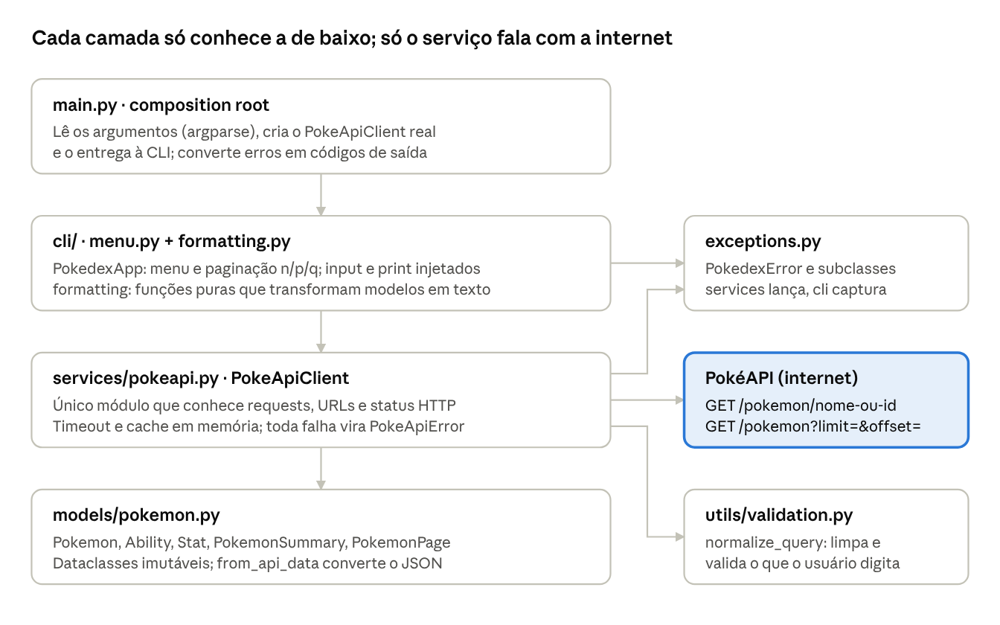

# Manual do Projeto Pokémon

17/10/2026 · Bernardo Gomes

## Visão geral

O **Pokedex CLI** é uma aplicação de linha de comando em Python que consulta a [PokéAPI](https://pokeapi.co/) para buscar Pokémon por nome ou número, listar Pokémon com paginação e mostrar detalhes (tipos, altura, peso, habilidades e stats). Ele implementa por completo a especificação do MVP (`DOC-20261001-WA0022.pdf`) e vai além dela em qualidade de engenharia.

O que o projeto demonstra para um recrutador de backend:

- **Consumo de API REST** com `requests`: sessão HTTP, timeout, status codes e JSON.
- **Separação de responsabilidades** em camadas: modelos, serviço de API e interface (CLI).
- **Tratamento de erros** com uma hierarquia de exceções própria, sem stack trace para o usuário.
- **Testes automatizados** com pytest, rodando sem internet graças à injeção de dependência e mocks.
- **Qualidade de código**: type hints verificados pelo mypy em modo estrito, lint e formatação com ruff, cobertura medida com pytest-cov e CI no GitHub Actions.

## Arquitetura

O projeto é dividido em camadas: cada uma tem uma responsabilidade e só depende das camadas abaixo dela. A especificação pede exatamente isso: separar interação com o usuário, comunicação com a API e representação dos dados.

As setas apontam de quem usa para quem é usado. Nenhuma seta sobe: o modelo não conhece o serviço, e o serviço não conhece a CLI. Para simplificar, o desenho omite duas setas que também descem: a CLI lê os modelos que recebe, e o `main.py` cria o serviço.

O caminho de uma busca, do teclado à tela:

1. `PokedexApp.search` (cli) lê `" Pikachu "` e chama `source.get_pokemon`.
2. `PokeApiClient.get_pokemon` (services) normaliza para `pikachu` com `normalize_query`; entrada inválida para aqui, sem requisição.
3. Se não estiver no cache, `_get_json` faz `GET /pokemon/pikachu` com timeout e traduz qualquer falha em `PokeApiError`.
4. `Pokemon.from_api_data` (models) transforma o JSON em objeto; um JSON fora do formato vira `InvalidResponseError`.
5. De volta à cli, `format_pokemon` gera o texto e o menu imprime. Se algo falhou, o menu imprime `str(error)`.

Arquivos do projeto:

| Caminho | Responsabilidade |
| --- | --- |
| `pokedex/__main__.py` | Permite `python -m pokedex` |
| `pokedex/main.py` | Argumentos, criação do cliente, códigos de saída, UTF-8 |
| `pokedex/exceptions.py` | Hierarquia `PokedexError` |
| `pokedex/models/pokemon.py` | Modelos do domínio |
| `pokedex/services/pokeapi.py` | Cliente HTTP da PokéAPI |
| `pokedex/cli/menu.py` | Menu interativo e paginação |
| `pokedex/cli/formatting.py` | Texto da tela de detalhes e da lista |
| `pokedex/utils/validation.py` | Normalização e validação da entrada |
| `tests/` | 7 módulos de teste, dublês (`doubles.py`) e respostas reais (`fixtures/`) |
| `pyproject.toml` | Pacote, comando `pokedex`, pytest, coverage, ruff e mypy |
| `.github/workflows/ci.yml` | CI no Ubuntu e no Windows |

## Como instalar e rodar

Com o `.venv` ativado, `python -m pokedex` abre o menu. Do zero, no PowerShell, a partir da pasta `projeto-pokemon`:

1. Criar o ambiente virtual (só uma vez): `py -m venv .venv`
2. Ativar o ambiente: `.\.venv\Scripts\Activate.ps1` (o prompt passa a mostrar `(.venv)`)
3. Instalar as dependências de desenvolvimento: `python -m pip install -r requirements-dev.txt`
4. Opcional, instalar o comando `pokedex`: `python -m pip install -e .`
5. Rodar: `python -m pokedex` (ou só `pokedex`, se fez o passo 4)

Comandos disponíveis:

| Comando | O que faz |
| --- | --- |
| `python -m pokedex` | Abre o menu interativo (1 Search, 2 List, 3 Exit) |
| `python -m pokedex search pikachu` | Mostra um Pokémon e sai |
| `python -m pokedex list --page 3 --limit 10` | Mostra uma página da lista e sai |
| `python -m pokedex --timeout 5 search mew` | Espera no máximo 5 s pela API |
| `python -m pokedex --help` / `--version` | Ajuda e versão (1.0.0) |

Códigos de saída (úteis em scripts): `0` sucesso, `1` erro esperado (não encontrado, API fora do ar), `2` argumento inválido, `130` interrompido com Ctrl+C.

Sobre o `pip install -e .`: o `-e` ("editable") instala o pacote apontando para a sua pasta, então qualquer mudança no código vale na hora, sem reinstalar. Quem define o comando `pokedex` é a seção `[project.scripts]` do `pyproject.toml`.

## Funcionalidades e exemplos de uso

Todos os requisitos da especificação foram atendidos; a tabela mostra cada um e onde ele vive no código.

| Requisito da especificação | Como foi atendido | Onde |
| --- | --- | --- |
| 1.1 Buscar por nome ou número | `pikachu`, `25`, `025`, `Mr. Mime`, `Flabébé` e `deoxys` funcionam | `utils/validation.py`, `services/pokeapi.py` |
| 1.2 Listar com paginação | 20 por página, `n` / `p` / `q`, sem baixar tudo | `cli/menu.py` (`browse`) |
| 1.3 Detalhes e stats | ID, nome, tipos, altura (m), peso (kg), habilidades e os 6 stats com barra | `cli/formatting.py` |
| 2 Menu principal | 1 Search, 2 List, 3 Exit; opção inválida tratada | `cli/menu.py` (`run`) |
| 3 Requisitos técnicos | `requests`, JSON, sem banco de dados, sem IA | `services/pokeapi.py` |
| 4 POO moderada | Classes onde representam o domínio (`Pokemon`, `PokeApiClient`, `PokedexApp`); funções puras no resto | todo o pacote |
| 5 Organização | `models/`, `services/`, `cli/`, `utils/` | `pokedex/` |
| 6 Tratamento de erros | Mensagem clara para os 6 casos, nunca stack trace | `exceptions.py` |

Mensagens que o usuário vê em cada erro da seção 6:

| Situação | Mensagem |
| --- | --- |
| Pokémon inexistente | Pokémon not found. |
| Entrada inválida | Invalid input: use only letters, numbers, spaces and hyphens. |
| Entrada vazia | Please enter a Pokémon name or number. |
| Erro HTTP (ex.: 429) | The PokéAPI returned an unexpected error (HTTP 429). |
| API indisponível / sem internet / 5xx | The PokéAPI is unavailable right now. Check your internet connection and try again. |
| Timeout | The PokéAPI took too long to respond (more than 10s). Please try again. |
| Resposta inválida | The PokéAPI sent an unexpected response. |

Extras além do MVP:

- **Comandos diretos** (`search`, `list`) além do menu, úteis em scripts.
- **Cache em memória**: voltar a uma página ou repetir uma busca não faz nova requisição. A política de uso justo da PokéAPI pede isso aos clientes.
- **Busca por espécie**: `deoxys` dá 404 em `/pokemon`, então o cliente consulta `/pokemon-species/deoxys` e pega a forma padrão, *Deoxys Normal*. Sem isso, cerca de 30 Pokémon não seriam encontráveis pelo nome.
- **Número da página** no cabeçalho: `Showing Pokémon 1-20 of 1351 (page 1/68)`.
- **Falha no meio da paginação** mantém o usuário na página atual em vez de jogá-lo de volta ao menu.
- **Ctrl+C e fim de entrada** encerram com "Goodbye!", sem stack trace.

## Testes e qualidade

São 183 testes unitários com 100% de cobertura de linhas e de ramos, rodando em menos de 2 segundos e **sem internet**, mais 5 testes de integração contra a API real.

| Arquivo | Testes | O que cobre |
| --- | --- | --- |
| `test_pokeapi_client.py` | 51 | URLs, status 404/429/5xx, timeout, sem conexão, JSON inválido, cache, busca por espécie |
| `test_models.py` | 38 | JSON → objetos, ordenação por slot, chaves faltando, tipos errados, paginação |
| `test_menu.py` | 31 | Menu, busca, n/p/q, limites da primeira e última página, falhas de rede |
| `test_validation.py` | 26 | Normalização (acentos, zeros, espaços) e entradas inválidas |
| `test_main.py` | 24 | Argumentos, códigos de saída, Ctrl+C, fim de entrada, BOM do PowerShell |
| `test_formatting.py` | 13 | Tela de detalhes completa (snapshot), unidades, lista alinhada |
| `test_integration.py` | 5 | PokéAPI real: pikachu, `001`, deoxys, inexistente, primeira página |

Comandos (com o `.venv` ativado):

| Comando | Para quê |
| --- | --- |
| `python -m pytest` | Testes unitários (os de integração ficam de fora) |
| `python -m pytest --cov` | Testes + relatório de cobertura (falha abaixo de 95%) |
| `python -m pytest -m integration` | Só os testes contra a API real |
| `python -m ruff check .` | Lint: bugs comuns, imports, estilo |
| `python -m ruff format .` | Formatação automática do código |
| `python -m mypy` | Checagem de tipos em modo estrito |

Como os testes rodam sem internet: o cliente recebe a `Session` do `requests` por parâmetro (injeção de dependência). Nos testes, o método `get` dessa sessão é trocado por um `Mock` que devolve respostas falsas ou lança `requests.Timeout`, por exemplo. Do mesmo jeito, o menu recebe `input` e `print` por parâmetro, e os testes passam um "teclado roteirizado" (`ScriptedInput`) e um coletor de saída.

As respostas de exemplo em `tests/fixtures/` são respostas **reais** da PokéAPI, salvas e recortadas. Assim os testes usam o formato verdadeiro da API, não um formato inventado.

O CI (`.github/workflows/ci.yml`) roda ruff, mypy e pytest a cada push, no Ubuntu e no Windows. Recrutadores costumam olhar o selo verde do CI e a pasta `tests/` antes de ler o código.

Verificação final feita em 2026-10-17: instalação do zero numa pasta limpa (venv novo, só os arquivos que iriam para o Git) passou em tudo, e o teste manual no PowerShell confirmou cada item da "Verificação final" do ROADMAP, incluindo o modo sem internet e o timeout.

## Decisões técnicas explicadas

Cada escolha abaixo responde a uma pergunta de arquitetura: quem é responsável pelo quê, e o que quebraria se fosse diferente.

### 1. Dataclasses imutáveis para o domínio

`Pokemon`, `Ability`, `Stat`, `PokemonSummary` e `PokemonPage` são `@dataclass(frozen=True)`. A dataclass gera `__init__`, `__eq__` e `__repr__` sozinha; o `frozen=True` impede alteração depois de criado. **Por quê:** o mesmo objeto fica guardado no cache e é devolvido várias vezes. Se alguém pudesse alterá-lo, uma parte do programa estragaria o dado de outra. Listas viram `tuple` pelo mesmo motivo.

### 2. O modelo converte o JSON, o serviço traduz os erros

`Pokemon.from_api_data(data)` sabe ler o JSON, mas, se falta uma chave, lança um `KeyError` comum. Quem transforma isso em `InvalidResponseError` é o `PokeApiClient`. **Por quê:** o modelo não deve saber que existe HTTP. Se amanhã os dados vierem de um arquivo ou de um banco, o modelo continua igual. As funções `_as_int` e `_as_str` rejeitam tipos errados (inclusive `True`, que em Python é um `int`).

### 3. Um único módulo conhece o `requests`

Só `services/pokeapi.py` importa `requests`, monta URLs e olha status codes. O método `_get_json` concentra tudo: timeout vira `ApiTimeoutError`, falha de conexão vira `ApiUnavailableError`, 404 vira `PokemonNotFoundError`, 5xx vira `ApiUnavailableError`, outros status viram `ApiHttpError`. **Por quê:** se um dia trocar `requests` por `httpx`, só um arquivo muda. O `raise ... from error` guarda a exceção original em `__cause__`, o que ajuda a depurar.

### 4. Hierarquia de exceções própria

Todas herdam de `PokedexError`; as de rede herdam de `PokeApiError`. A CLI só precisa de um `except PokedexError` para tratar tudo, e cada classe já traz a mensagem para o usuário. **Por quê:** erros esperados viram mensagens; erros inesperados (bugs de verdade) continuam aparecendo, em vez de serem escondidos por um `except Exception`.

### 5. Injeção de dependência

O cliente recebe a `Session`; o menu recebe a fonte de dados, `input` e `print`; o `main` recebe um `source` opcional. **Por quê:** quem usa não cria suas dependências, então os testes podem trocar cada uma por um dublê. É o que permite 183 testes sem internet e sem teclado. O `main.py` é a "composition root": o único lugar que cria o cliente real.

### 6. `Protocol` em vez de herança

`PokemonSource` (em `cli/menu.py`) descreve o que o menu precisa: `get_pokemon` e `list_pokemon`. Qualquer classe com esses métodos serve, sem herdar de nada (tipagem estrutural, o "duck typing" verificado pelo mypy). **Por quê:** o menu depende de uma interface, não da implementação concreta. O `FakeSource` dos testes cumpre o mesmo contrato.

### 7. Formatação como funções puras

`format_pokemon` e `format_page` recebem dados e devolvem `str`, sem imprimir. **Por quê:** a apresentação fica trivial de testar (comparação de strings) e reutilizável. Nem tudo precisa ser classe, como pede a especificação: a POO aparece onde há estado (cliente com cache, menu com dependências).

### 8. Validar antes de chamar a API

`normalize_query` limpa a entrada (`" Mr. Mime "` → `mr-mime`, `025` → `25`, `Flabébé` → `flabebe`) e rejeita o que nunca seria um Pokémon. **Por quê:** economiza requisições inúteis e impede que algo como `../pokemon` altere a URL. Pelo mesmo motivo, o nome que vem da rota de espécie também é validado antes de entrar numa URL.

### 9. Timeout e cache

Toda requisição tem timeout (10 s, configurável com `--timeout`). Sem timeout, o `requests` pode esperar para sempre e o programa congela. O cache em dicionário guarda Pokémon por nome, número e texto buscado, e páginas por `(limit, offset)`. Erros não são guardados, então tentar de novo funciona.

### 10. Entrada e saída no Windows

O teste manual revelou um bug real: ao fazer pipe de texto no PowerShell 5.1 (`"3" | python -m pokedex`), a primeira linha chega precedida de um BOM, o caractere invisível U+FEFF que marca "este texto é UTF-8". O menu recebia BOM + `1` em vez de `1` e respondia "Invalid option". `_configure_text_streams` em `main.py` lê a entrada redirecionada com o codec `utf-8-sig`, que descarta o BOM, e escreve sempre em UTF-8. A correção fica na fronteira de E/S, não no menu, e tem teste de regressão que falha sem ela.

### 11. Ferramentas

| Ferramenta | Papel | Por que no mercado |
| --- | --- | --- |
| pytest + pytest-cov | Testes e cobertura | Padrão de fato em Python |
| ruff | Lint e formatação | Substitui flake8, isort e black, muito mais rápido |
| mypy (strict) | Checagem de tipos | Pega erros antes de rodar; comum em backends grandes |
| GitHub Actions | CI | Mostra que o projeto é verificado automaticamente |
| pyproject.toml | Configuração única | Padrão moderno (PEP 621) |

## Histórico do que foi feito

O projeto saiu da Etapa 0 (ambiente) para a versão 1.0.0 completa em 2026-10-17, seguindo as etapas do `ROADMAP.md`.

| Etapa | O que foi feito | Arquivos |
| --- | --- | --- |
| 0. Ambiente e Git (2026-10-10) | `.venv`, requirements, ruff e pytest configurados, primeiro commit | `pyproject.toml`, `.gitignore` |
| 1. Explorar a PokéAPI | Respostas reais analisadas; descobertas: `025` dá 404, altura em decímetros, peso em hectogramas, `deoxys` só existe como espécie | `tests/fixtures/*.json` |
| 2. Modelos | Dataclasses imutáveis e `from_api_data` com validação de tipos | `models/pokemon.py` |
| 3. Cliente da API | `PokeApiClient` com `Session` injetada, timeout, paginação e cache | `services/pokeapi.py` |
| 4. Tratamento de erros | Hierarquia `PokedexError` e tradução de timeout, conexão, 404, 5xx e JSON inválido | `exceptions.py` |
| 5. Exibição e busca | Formatação pura com conversão de unidades; validação de entrada | `cli/formatting.py`, `utils/validation.py` |
| 6. Listagem paginada | Loop n/p/q com limites e recuperação de falhas | `cli/menu.py` |
| 7. Menu principal | Menu 1/2/3, `python -m pokedex`, Ctrl+C limpo, comandos `search` e `list` | `cli/menu.py`, `main.py`, `__main__.py` |
| 8. Acabamento | ruff e mypy limpos, 100% de cobertura, README, CI, licença, instalação com `pip install -e .` | `README.md`, `.github/workflows/ci.yml` |
| 9. Além do MVP | Busca por espécie, acentos, número da página, correção do BOM | vários |

Bugs e problemas encontrados durante o trabalho, e como cada um foi resolvido:

| Problema | Causa | Solução |
| --- | --- | --- |
| Primeira opção do menu dava "Invalid option" via pipe | BOM do PowerShell 5.1 na entrada | Codec `utf-8-sig` na entrada + teste de regressão |
| `Pokémon` aparecia como `Pok�mon` no Git Bash | Saída redirecionada usava cp1252 | Saída sempre em UTF-8 |
| `deoxys` e `giratina` não eram encontrados | A API usa o nome da forma (`deoxys-normal`) | Fallback para `/pokemon-species` |
| `025` dava "not found" | A API não aceita zeros à esquerda | `normalize_query` converte para `25` |
| mypy recusou o dublê de stdin herdando de `StringIO` | Assinatura de `readline` incompatível nos stubs | Classe simples só com `readline` |

Git e GitHub (2026-10-17): o trabalho virou 5 commits, enviados ao repositório público [github.com/BernardoOGomes/pokedex-cli](https://github.com/BernardoOGomes/pokedex-cli). Um sexto commit, com o arquivo de CI, está só no computador: o GitHub recusou o envio porque o login do `gh` não tem a permissão `workflow`. Para enviar, rode `gh auth refresh -h github.com -s workflow` e depois `git push`.

## Próximos passos e perguntas de revisão

O código foi escrito de uma vez, então o aprendizado agora vem de estudá-lo. Sugestão de ordem de leitura: `exceptions.py` → `models/pokemon.py` → `utils/validation.py` → `services/pokeapi.py` → `cli/formatting.py` → `cli/menu.py` → `main.py`, abrindo o arquivo de teste correspondente ao lado de cada um.

Passos imediatos:

- [ ] Conceder a permissão workflow ao gh e enviar o commit do CI
- [ ] Conferir o repositório público `pokedex-cli` no GitHub (README, tópicos e, depois do CI, o selo verde)
- [ ] Estudar a Apostila: Claude, IA e Python na prática e responder as perguntas abaixo (pode ser no chat, uma etapa por vez)

Perguntas de revisão, focadas em arquitetura:

1. Por que `Pokemon.from_api_data` lança `KeyError`, e não `InvalidResponseError`? O que mudaria se o modelo importasse `exceptions` da camada de serviço?
2. O que quebraria nos testes se `PokeApiClient` criasse sua própria `Session` sem aceitá-la por parâmetro?
3. Por que `format_pokemon` devolve uma `str` em vez de chamar `print`?
4. A CLI captura `PokedexError`, mas não `Exception`. Que tipo de problema continuaria mostrando stack trace, e por que isso é desejável?
5. Por que o `Pokemon` é `frozen=True`? Que bug poderia aparecer junto com o cache se não fosse?
6. Por que os testes de integração ficam desligados por padrão?
7. Onde a correção do BOM foi feita, e por que nessa camada e não no menu?
8. Se você fosse transformar isso numa API web com FastAPI, quais módulos reaproveitaria sem mudar nada, e qual substituiria?

Melhorias futuras, em ordem de valor para o portfólio de backend:

- **API web com FastAPI** reaproveitando `models` e `services` (ex.: `GET /pokemon/{name}`), com testes via `TestClient`.
- **Cache persistente** em SQLite entre execuções, praticando banco de dados.
- **Retentativas com backoff** para 429 e 503 (via `urllib3.Retry`).
- **Busca por tipo ou habilidade** e cadeia de evolução.
